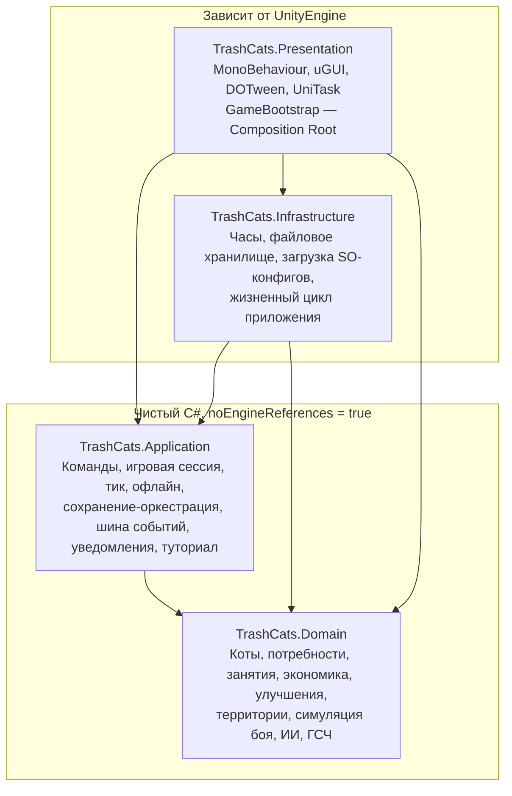
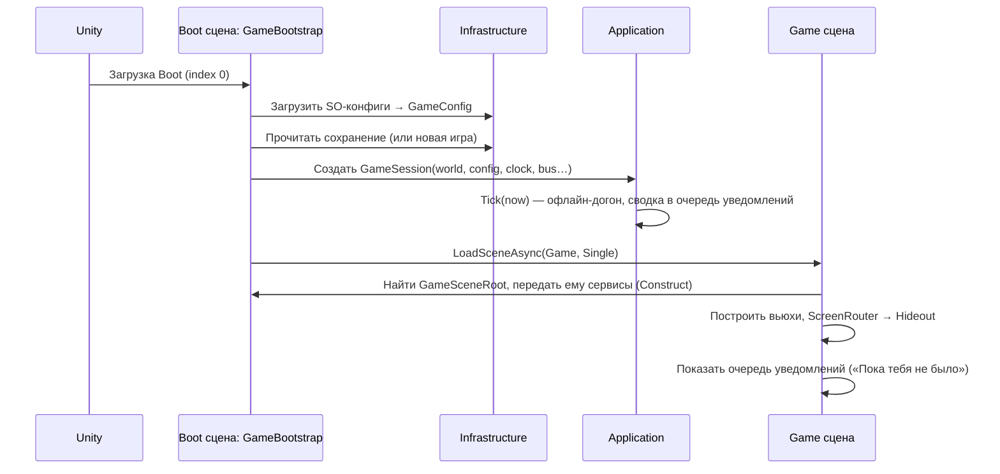

# Trash Cats — Обзор архитектуры

> Статус: черновик v0.1 (фаза D). Основан на утверждённом GDD (`Docs/GDD/`).
> **Это план. Production-код не пишется до явного разрешения.** Псевдокод в документах иллюстративный.

## 1. Принятые технические решения

| Решение | Выбор | Статус | Почему |
|---|---|---|---|
| Архитектурный стиль | **PDA** (Presentation / Domain / Application) + тонкий слой Infrastructure | ✅ | Правила игры отделены от Unity, тестируются без движка |
| DI | **Без фреймворка**, ручной Composition Root (`GameBootstrap`), внедрение через конструкторы | ✅ | ~20 сервисов, явные связи, нет рефлексии и рисков IL2CPP |
| UI | **uGUI** (Canvas) | ✅ | Зрелый мобильный стек, DOTween, World Space UI над котами |
| Сцены | **Boot + Game** | ✅ | Мир живёт вне сцен; переходы между экранами мгновенные |
| Async | **UniTask** — только в Presentation/Infrastructure | 🔶 | Проигрывание боя, переходы экранов, сохранение в фоне |
| Твины | **DOTween** — только в Presentation | 🔶 | UI и анимации презентации |
| Конфиги | **ScriptableObject** → маппинг в неизменяемые доменные конфиги при загрузке | 🔶 | Удобно гейм-дизайнеру, домен не зависит от Unity |
| Сохранения | **JSON** через `com.unity.nuget.newtonsoft-json` (официальный пакет Unity) | 🔶 | Читаемо, поддерживает словари и версионирование; JsonUtility не умеет `Dictionary` и nullable |
| События | Своя типизированная шина (~50 строк) | 🔶 | Хватает для прототипа; MessagePipe/SignalBus не нужны |
| Анимации персонажей | **Откладывается до фазы F** (выбор арт-стиля); код работает через абстракцию `ICatAnimator` | 🔶 | Технология (2D Animation, покадровая, Spine) зависит от стиля |
| Тесты | Unity Test Framework (NUnit), EditMode для домена и приложения | 🔶 | Пакет уже установлен в проекте |

**Состояние репозитория на момент планирования:** Unity 6000.0.74f1, URP, 2D feature set, Input System, Test Framework. Не установлены: UniTask, DOTween, Newtonsoft JSON. Проект не под git.

## 2. Слои и направление зависимостей



**Правила:**
1. `Domain` не ссылается ни на что (кроме BCL). `noEngineReferences: true` — компилятор не даст использовать `UnityEngine`.
2. `Application` ссылается только на `Domain`, тоже без движка. Внешний мир виден ему через интерфейсы (`IClock`, `ISaveStorage`), которые реализует `Infrastructure`.
3. `Infrastructure` — адаптеры к Unity и файловой системе. Бизнес-логики нет.
4. `Presentation` читает состояние через read-only интерфейсы, меняет его **только через команды Application** и подписывается на события.
5. MonoBehaviour никогда не содержит игровых правил (формул, порогов, наград).

Зачем отдельный `Infrastructure` при «PDA»: без него `IClock`/`ISaveStorage` пришлось бы реализовывать в Presentation, смешивая UI с файловым I/O. Это одна небольшая сборка, а не новый слой абстракций.

## 3. Ключевые архитектурные идеи

### 3.1. Мир — один агрегат, время — одно число
- Всё изменяемое состояние игры — объект `GameWorld` (коты, ресурсы, улучшения, территории, туториал, ожидающий бой).
- Время в домене — **внутреннее монотонное `GameTimeMs` (long)**. Оно растёт на «прошедшее реальное время», обрезанное до лимита. Перевод часов назад — это просто нулевой шаг.
- Единственный способ продвинуть мир — `Simulation.AdvanceTo(targetGameTime)`. Он обрабатывает завершения циклов **в хронологическом порядке по всем котам** (при равенстве — по индексу кота).

### 3.2. Онлайн и офлайн — один и тот же код
```
каждый кадр:         session.Tick(clock.UtcNow)       → AdvanceBy(min(Δ, cap))
возврат в игру:      session.Tick(clock.UtcNow)       → тот же путь, Δ большая → лимит 60 мин
```
Эквивалентность офлайна и онлайна обеспечена конструкцией, а не отдельной реализацией, и проверяется тестом.

### 3.3. Команда = «догнать время → проверить → изменить → собрать события → опубликовать»
```
Result Execute(command):
    world.AdvanceTo(now)                 // состояние актуально на момент команды
    error = command.Validate(world)      // никаких изменений, если невалидно
    if error: return Fail(error)
    events = command.Apply(world)        // атомарно, события копятся в списке
    bus.PublishAll(events)               // только после завершения изменения
    saveScheduler.MarkDirty(command.Importance)
    return Ok
```
Всё выполняется в главном потоке. Гонок между «завершилось занятие» и «игрок нажал кнопку» нет: перед командой мир всегда догоняется до текущего момента, а события публикуются после изменения состояния, поэтому подписчики не видят полуизменённый мир.

### 3.4. Бой — чистая функция
```
BattleResult BattleSimulator.Simulate(BattleSetup setup, int seed)
```
- Нет зависимостей от времени мира, Unity, анимаций.
- Целочисленная арифметика (HP, урон, шансы в промилле), свой ГСЧ (xorshift) → полностью детерминирован.
- Результат — итог + **лог событий** с номерами тиков. Презентация проигрывает лог с любой скоростью или пропускает его.
- Мир во время показа боя продолжает жить (остальные коты работают).

### 3.5. Презентация пассивна
- Вьюхи читают состояние (`IReadOnlyGameWorld`) и обновляются по событиям.
- Прогресс-бары каждый кадр запрашивают `GetCycleProgress(catId, now)` — чистый запрос без изменений.
- Анимации вызываются по состоянию (кот в `Working(train_str)` → цикл `train_punch`), а не наоборот.

## 4. Структура проекта (папки)

```
Assets/
  _Project/
    Scripts/
      Domain/            TrashCats.Domain.asmdef
      Application/       TrashCats.Application.asmdef
      Infrastructure/    TrashCats.Infrastructure.asmdef
      Presentation/      TrashCats.Presentation.asmdef
    Tests/
      EditMode/          TrashCats.Tests.EditMode.asmdef (→ Domain, Application)
      PlayMode/          TrashCats.Tests.PlayMode.asmdef (→ всё)
    Configs/             *.asset (ScriptableObject-конфиги)
    Scenes/              Boot.unity, Game.unity
    Prefabs/  Art/  Audio/  UI/  Localization/
```

## 5. Сцены и запуск



- `GameBootstrap` живёт в Boot и помечен `DontDestroyOnLoad`; он владеет сессией и тиком (`Update` → `session.Tick`).
- `Game.unity` содержит корни: `HideoutRoot`, `MapRoot`, `ArenaRoot`, `UIRoot` (Canvas'ы). Переключение экранов — включение/выключение корней через `ScreenRouter`.
- Запуск Game-сцены напрямую в редакторе: `GameSceneRoot` при отсутствии бутстрапа загружает Boot (удобство разработки).

## 6. Ответы на технические вопросы брифа

| Вопрос | Решение |
|---|---|
| Централизованный планировщик занятий? | **Да, но не таймерный.** `ActivitySystem` в домене хранит у каждого кота время начала и длительность цикла, а `Simulation.AdvanceTo` находит ближайшее завершение по всем котам и обрабатывает его. Нет корутин и `Invoke`. |
| Как коты работают одновременно? | Каждый кот — независимая запись `Working{activity, start, duration}`. Общие ресурсы (станции, склад) меняются только в упорядоченной обработке завершений. |
| Как представлено время? | `GameTimeMs` (long) — внутренний монотонный счётчик в сохранении; реальное время используется только для расчёта Δ. |
| Бой независим от мира? | Да. Симуляция — чистая функция от снимка бойцов и seed. Мир лишь помечает котов `InBattle` и применяет последствия. |
| Детерминизм и тестируемость боя? | Целочисленная математика, свой ГСЧ, seed = хэш(SaveSeed, TerritoryId, AttemptIndex); тесты «одинаковый вход → одинаковый лог» и балансный симулятор. |
| Отделение логики боя от анимаций? | Лог событий → `BattlePlayer` (Presentation) проигрывает его и ждёт твины/анимации; симуляция их никогда не ждёт. |
| Гонки при завершении занятий? | Один поток; хронологическая обработка; команды сначала догоняют время; события публикуются после изменения. |
| Сериализация активных занятий? | Сохраняем `{activityId, cycleStartGameTime, cycleDurationMs}` — этого достаточно для точного восстановления. Никаких «оставшихся секунд». |
| Сворачивание и возврат? | `OnApplicationPause(true)` → немедленное сохранение. Возврат → обычный `Tick` с большой Δ (лимит 60 мин) → сводка. |
| Как не переусложнить? | 4 сборки, без DI-фреймворка, без ECS, без command-queue/undo, без сетевого слоя; интерфейсы только на внешних границах (часы, хранилище, анимация). |

## 7. Что сознательно НЕ делаем
- Нет абстрактных «систем-плагинов», реестров модулей, сервис-локаторов.
- Нет отдельной модели «View-Model» для каждого виджета: презентеры читают домен напрямую через read-only интерфейсы.
- Нет многопоточности.
- Нет Addressables (контента мало; всё в сцене/Resources-free ссылках через SO).
- Нет универсальной state-machine-библиотеки: два небольших автомата (занятие кота, экранный роутер) пишутся явно.

## 8. Связанные документы
- [MODULES.md](MODULES.md) — модули, ответственность, операции, зависимости, тесты.
- [DATA_MODELS.md](DATA_MODELS.md) — доменные модели, конфиги, DTO сохранений.
- [STATE_MANAGEMENT.md](STATE_MANAGEMENT.md) — время, симуляция, автоматы, события, UI-навигация, бой.
- [SAVE_SYSTEM.md](SAVE_SYSTEM.md) — формат, версии, триггеры, восстановление.
- [TECHNICAL_RISKS.md](TECHNICAL_RISKS.md) — риски и митигации.
