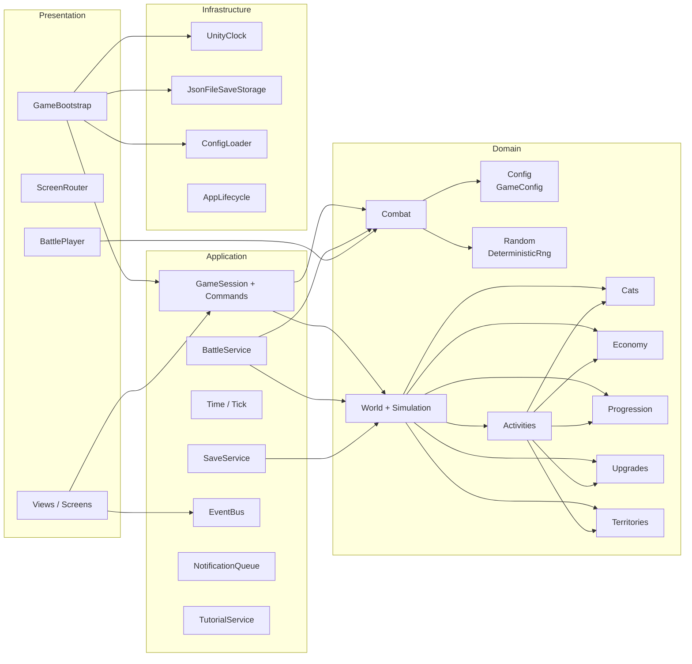

# Trash Cats — Модули

> Статус: черновик v0.1 (фаза D). Для каждого модуля: ответственность, данные, операции, зависимости, обработка невалидных состояний, тесты.
> Имена классов — рабочие, могут уточняться при реализации.

## Карта модулей

---

## 1. Domain

### 1.1. Config (`Domain/Config`)
- **Ответственность:** неизменяемое описание баланса и контента: коты, враги, умения, занятия, улучшения, территории, формулы-коэффициенты.
- **Данные:** `GameConfig` и вложенные записи (см. [DATA_MODELS.md](DATA_MODELS.md#1-конфигурация)).
- **Операции:** только чтение, `GetCat(id)`, `GetSkill(id)` и т.д. `Validate()` → список ошибок (дубли id, ссылки на несуществующие id, отрицательные значения).
- **Зависимости:** нет.
- **Невалидные состояния:** `ConfigLoader` вызывает `Validate()` при старте; в Development-сборке ошибки — исключение с перечнем, в Release — лог + фатальный экран.
- **Тесты:** валидация на заведомо битых конфигах; «боевой» конфиг из ассетов проходит валидацию (PlayMode/EditMode через загрузку SO).

### 1.2. Random (`Domain/Random`)
- **Ответственность:** детерминированный ГСЧ (xorshift32/PCG), независимый от `UnityEngine.Random` и `System.Random` (реализация последнего может отличаться между рантаймами).
- **Операции:** `NextInt(min, maxExclusive)`, `RollPermille(chance)`, `static Seed Combine(params int[])`.
- **Тесты:** фиксированный seed → фиксированная эталонная последовательность (golden test).

### 1.3. Cats (`Domain/Cats`)
- **Ответственность:** состояние котов: атрибуты, опыт, потребности, слоты умений, вербовка.
- **Данные:** `Cat { Id, Attributes[3], Energy, Satiety, EquippedSkills[3], Activity, IsRecruited }`.
- **Операции:**
  - `AddXp(attribute, amount) → List<DomainEvent>` (LevelUp, SkillUnlocked; перенос излишка; кап 10).
  - `ChangeNeeds(energyDelta, satietyDelta)` с обрезкой 0..100.
  - `Feed(availableFood) → foodSpent` (`ceil((100−Satiety)/10)`, не больше доступного).
  - `EquipSkill(slot, skillId)` — проверка «умение открыто», «не дублируется в другом слоте».
  - Запросы: `IsTired`, `IsHungry`, `IsSkillUnlocked(id)`, `GetCombatStats()`.
- **Зависимости:** Config.
- **Невалидные состояния:** потребности всегда обрезаются; опыт на 10 уровне не начисляется; экипировка неоткрытого умения → `Fail(SkillLocked)`.
- **Тесты:** уровни и перенос опыта; мультиуровень за одно начисление; открытие умений на порогах; кормление при нехватке еды; обрезка.

### 1.4. Activities (`Domain/Activities`)
- **Ответственность:** правила занятий: старт, длительность, завершение, отмена, автоповтор, занятость станций.
- **Данные:** у кота `ActivityState = Idle(reason) | Working(activityId, cycleStart, cycleDuration, manualHungryOverride) | InBattle`. Занятость станций вычисляется из состояний котов (не хранится отдельно → не может рассинхронизироваться).
- **Операции:**
  - `CanStart(cat, activityId, world) → Ok | Fail(Tired | StationBusy | AttributeMaxed | InBattle | AlreadyFull)`.
  - `Start(cat, activityId, now)` — фиксирует длительность (голод ×2).
  - `CompleteCycle(cat, world) → events` — применяет стоимость и награду атомарно, решает про автоповтор.
  - `Stop(cat, reason)` — без стоимости и награды.
  - `GetNextCompletionTime(cat)`, `GetCycleProgress(cat, now)`.
- **Зависимости:** Cats, Economy, Progression (опыт), Upgrades (бонусы), Territories (бонусы), Config.
- **Невалидные состояния:** `Start` без успешного `CanStart` — исключение (ошибка программиста); `CompleteCycle` у не-`Working` кота — исключение.
- **Тесты:** все строки таблицы правил из `CORE_SYSTEMS.md §3.3` и граничных случаев §3.5; два кота и одна станция; голод ×2 фиксируется на старте; автоповтор останавливается с правильной причиной.

### 1.5. Economy (`Domain/Economy`)
- **Ответственность:** склад банды.
- **Данные:** `Wallet { Food, Junk }` (int ≥ 0).
- **Операции:** `Add(resource, amount)`, `TrySpend(resource, amount) → bool`, `Has(resource, amount)`.
- **Невалидные состояния:** отрицательные суммы → исключение; `TrySpend` без средств → `false`, без изменений.
- **Тесты:** тривиальные + отсутствие отрицательного баланса.

### 1.6. Progression (`Domain/Progression`)
- **Ответственность:** формулы опыта: `XpToNext(level)`, расчёт опыта за цикл (склонность + станция + территория), пороги умений, опыт за бой.
- **Операции:** чистые функции над Config.
- **Тесты:** таблица из `PROGRESSION_AND_ECONOMY.md §2.1` как эталон.

### 1.7. Upgrades (`Domain/Upgrades`)
- **Ответственность:** уровни 5 объектов убежища и их эффекты.
- **Данные:** `Dictionary<UpgradeId, int level>`.
- **Операции:** `CanBuy(id, wallet) → Ok | Fail(MaxLevel | NotEnoughJunk)`, `Buy(id, wallet) → events`, `GetEffect(id)` (бонус сна, выход ресурсов, бонус опыта станции).
- **Тесты:** покупка, нехватка, максимум, эффект применяется со следующего цикла.

### 1.8. Territories (`Domain/Territories`)
- **Ответственность:** открытие и захват территорий, пассивные бонусы, вербовка, награды (первая/повторная), счётчик попыток.
- **Данные:** `Dictionary<TerritoryId, TerritoryState { Status: Locked|Available|Captured, Attempts }>`.
- **Операции:** `IsAvailable(id)`, `GetReward(id) → first|repeat`, `ApplyVictory(id, world) → events` (захват, следующая открыта, бонус, вербовка, финал), `RegisterAttempt(id) → attemptIndex`, `GetPassiveBonuses()`.
- **Тесты:** линейное открытие; повторная награда 30% с округлением вверх; вербовка только при первой победе; финал после крыши.

### 1.9. Combat (`Domain/Combat`)
- **Ответственность:** симуляция боя-эстафеты, ИИ, лог.
- **Данные (вход):** `BattleSetup { PlayerFighters[], EnemyFighters[] }` — снимки `FighterSnapshot { Id, Str, Agi, Tou, Skills[], HpMultiplier }`; `seed`.
- **Данные (выход):** `BattleResult { Outcome, FoughtPlayerIds[], Log: List<BattleEvent>, TotalTicks }`.
- **Операции:** `BattleSimulator.Simulate(setup, seed)`; внутри — `CombatAi.ChooseAction(self, opponent)`, `CombatFormulas` (целочисленные).
- **Зависимости:** Config (умения, коэффициенты), Random.
- **Невалидные состояния:** пустая очередь любой стороны — исключение; защитный предел 10 000 тиков (не должен достигаться из-за «Ярости») → исключение в тестах, принудительное поражение игрока в рантайме + лог ошибки.
- **Тесты:** детерминизм (golden log для 3–4 сценариев); формулы; каждое умение и правило ИИ; эстафета (HP сохраняется, баффы сбрасываются); «Ярость»; **балансный симулятор** — прогон территорий против ожидаемых составов на N seed с выводом шанса победы (тест-отчёт, проверка коридоров).

### 1.10. World + Simulation (`Domain/World`)
- **Ответственность:** корневой агрегат и продвижение времени.
- **Данные:** `GameWorld { GameTimeMs, SaveSeed, Cats, Wallet, Upgrades, Territories, Tutorial, PendingBattle?, Flags }`.
- **Операции:**
  - `Simulation.AdvanceTo(world, targetTime) → events` — цикл «ближайшее завершение → CompleteCycle», пока оно ≤ target, затем `GameTimeMs = target`.
  - `IReadOnlyGameWorld` — интерфейс только для чтения (для Presentation).
  - `GameWorld.CreateNew(config, seed)`.
- **Тесты:** хронологический порядок завершений у трёх котов; эквивалентность `AdvanceTo(T)` и серии `AdvanceTo(t1..tn=T)`; «тупика нет» (property-тест: из случайных состояний Еда=0 существует действие, увеличивающее Еду).

---

## 2. Application

### 2.1. GameSession + команды (`Application/Session`)
- **Ответственность:** единая точка изменения мира; выполнение команд по схеме «догнать → проверить → применить → опубликовать».
- **Данные:** ссылка на `GameWorld`, `GameConfig`, `IClock`, `EventBus`, `SaveScheduler`, `TimeScale` (отладка).
- **Операции (фасад для Presentation):**

| Команда | Валидация | Эффект |
|---|---|---|
| `AssignActivity(catId, activityId)` | `Activities.CanStart` | Стоп текущего (если есть) → старт |
| `StopActivity(catId)` | Кот `Working` | `Idle(Stopped)` |
| `FeedCat(catId)` | Не `InBattle`, Еда > 0, Сытость < 100 | Списать еду, +Сытость |
| `BuyUpgrade(upgradeId)` | `Upgrades.CanBuy` | Списать хлам, уровень +1 |
| `EquipSkill(catId, slot, skillId?)` | Открыто, не дубль | Слот изменён |
| `StartBattle(territoryId, orderedCatIds)` | Территория доступна; 1–3 кота; Энергия ≥ 20; нет `PendingBattle` | См. BattleService |
| `CompleteBattle()` | Есть `PendingBattle` | Применить последствия |
| `CompleteTutorialStep(stepId)` | Шаг активен | Прогресс туториала |

- **Возврат:** `CommandResult { Ok | Fail(ErrorCode) }`. Presentation показывает локализованную причину по `ErrorCode`.
- **Тесты:** каждая команда с фейковыми часами: успех, каждая причина отказа, отсутствие изменений при отказе, корректные события.

### 2.2. Time / Tick (`Application/Time`)
- **Ответственность:** перевод реального времени в игровое.
- **Операции:** `Tick(utcNow)`: `Δ = clamp(utcNow − lastUtc, 0, OfflineCapMs) × TimeScale`; `world.AdvanceTo(world.GameTimeMs + Δ)`; `lastUtc = utcNow`. Если `Δ_real ≥ 60 с` — сформировать `OfflineSummary` из событий догона и положить в очередь уведомлений.
- **Тесты:** перевод часов назад (Δ=0); большой Δ обрезается; сводка собирается только при большом Δ.

### 2.3. BattleService (`Application/Battle`)
- **Ответственность:** подготовка снимков, seed, фиксация результата, применение последствий.
- **Операции:**
  - `Start(territoryId, cats)`: отменить занятия выбранных котов → `InBattle`; `attempt = Territories.RegisterAttempt`; `seed = Combine(SaveSeed, territory, attempt)`; `result = Simulate(...)`; `world.PendingBattle = {territory, cats, result}`; **немедленное сохранение**.
  - `Complete()`: применить последствия (Энергия, Сытость, опыт участникам; награда; захват; вербовка) → коты `Idle` → `PendingBattle = null` → сохранение.
  - `GetBattleView()` — данные для экрана боя (снимки + лог).
- **Тесты:** результат зафиксирован до показа; перезапуск с `PendingBattle` → тот же результат; последствия только для вышедших на ринг.

### 2.4. EventBus (`Application/Events`)
- **Ответственность:** доставка доменных событий подписчикам Presentation.
- **Операции:** `Subscribe<T>(Action<T>) → IDisposable`, `Publish<T>(T)`, `PublishAll(IEnumerable<DomainEvent>)`.
- **Правила:** синхронная доставка в главном потоке; публикация из обработчика события ставится в очередь и доставляется после текущей (нет рекурсии); исключение в подписчике логируется и не ломает остальных.
- **Тесты:** порядок доставки; отписка; реентрантность.

### 2.5. NotificationQueue (`Application/Notifications`)
- **Ответственность:** превращает события в очередь уведомлений-данных (модалки FIFO, тосты), учитывая приоритеты: уровень → умение → кот → территория.
- **Данные:** `Queue<Notification>` (не сохраняется, кроме сводки офлайна — она пересоздаётся).
- **Операции:** `Enqueue`, `TryDequeueModal`, `DrainToasts`, `SuspendModals()/ResumeModals()` (во время боя).
- **Тесты:** приоритеты и FIFO; подавление во время боя.

### 2.6. TutorialService (`Application/Tutorial`)
- **Ответственность:** данные шагов онбординга и контекстных подсказок; реакция на события («первый Хлам») → шаг активен; хранение пройденных шагов в мире.
- **Операции:** `CurrentStep`, `OnEvent(e)`, `Complete(stepId)`, `Skip()`.
- **Тесты:** последовательность ведущей цепочки; одноразовость подсказок; пропуск.

### 2.7. SaveService (`Application/Save`)
- **Ответственность:** когда и что сохранять; маппинг `GameWorld ↔ SaveData`; миграции. Запись на диск — через `ISaveStorage`.
- Подробно — [SAVE_SYSTEM.md](SAVE_SYSTEM.md).

### 2.8. Debug (`Application/Debug`, только Development)
- `TimeScale` (×1…×20), «+100 Еды/Хлама», «выиграть бой», «сбросить сохранение», «перемотать на N минут». Используется в плейтестах баланса.

---

## 3. Infrastructure

| Класс | Реализует | Ответственность | Тесты |
|---|---|---|---|
| `SystemClock` | `IClock` | `DateTime.UtcNow` в мс | — |
| `JsonFileSaveStorage` | `ISaveStorage` | Атомарная запись (temp → replace), бэкап, чтение | EditMode во временной папке |
| `ConfigLoader` | — | `GameConfigAsset` (SO) → `GameConfig` + `Validate()` | Загрузка боевого конфига проходит валидацию |
| `AppLifecycleListener` | — | `OnApplicationPause/Focus/Quit` → `SaveService.SaveNow()` и `Tick` при возврате | PlayMode smoke |

---

## 4. Presentation

| Компонент | Ответственность | Слушает события | Вызывает команды |
|---|---|---|---|
| `GameBootstrap` | Composition Root: создаёт всё, владеет `Update → Tick`, передаёт сервисы в Game-сцену | — | — |
| `GameSceneRoot` | Получает сервисы, строит вьюхи (`Construct(...)`) | — | — |
| `ScreenRouter` | Экраны (Hideout, Map, BattlePrep, Combat) + модальный слой + очередь | Navigation-запросы | — |
| `HudView` | Еда/Хлам, настройки | `ResourcesChanged` | — |
| `HideoutView` | Сцена: позиции котов у станций, объекты по уровням | `ActivityStarted/Stopped`, `UpgradePurchased`, `CatRecruited` | `BuyUpgrade` (через панель) |
| `CatView` | Спрайт/риг кота, анимация по состоянию, пузыри, всплывающие результаты | `ActivityCycleCompleted`, `ActivityStopped` | — |
| `CatPanelView` | 3 карточки внизу, бары потребностей, прогресс | `NeedsChanged` + опрос прогресса | `FeedCat` |
| `ActivitySheet` | Лист занятий, недоступные кнопки с причинами (`CanStart`) | — | `AssignActivity`, `StopActivity`, `FeedCat` |
| `CatDetailsSheet` | Атрибуты, опыт, слоты | `AttributeLevelUp`, `SkillUnlocked` | `EquipSkill`, `FeedCat` |
| `MapScreen` | Узлы территорий | `TerritoryCaptured` | — |
| `BattlePrepScreen` | Состав, порядок, слоты, подтверждение отмены занятий | — | `StartBattle`, `EquipSkill` |
| `CombatScreen` + `BattlePlayer` | Проигрывание лога (UniTask + DOTween), ×1/×2, пропуск | — | `CompleteBattle` (из окна итогов) |
| `ResultsModal` | Итоги, анализ поражения | — | — |
| `PopupPresenter` / `ToastView` | Отображение `NotificationQueue` | `NotificationEnqueued` | — |
| `TutorialOverlay` | Затемнение с вырезом, стрелка, текст | `TutorialStepChanged` | `CompleteTutorialStep` |
| `SafeAreaFitter` | Подгонка RectTransform под `Screen.safeArea` | — | — |
| `ICatAnimator` (+ реализация после фазы F) | `Play(CatAnim, loop)`, `PlayOnce(...) → UniTask` | — | — |

**Тесты Presentation:** PlayMode smoke: Boot → Game загружается, экран Убежища активен, команда `AssignActivity` из UI-кнопки меняет состояние кота. Визуальная корректность — ручной чек-лист.

---

## 5. Сводка зависимостей (кто кого знает)

| Модуль | Знает о |
|---|---|
| Domain.* | Config, Random, друг о друге внутри Domain по графу выше |
| Application.* | Domain, интерфейсы `IClock`, `ISaveStorage` |
| Infrastructure | Domain, Application (интерфейсы), UnityEngine, Newtonsoft |
| Presentation | Всё выше, UnityEngine, uGUI, DOTween, UniTask |

Никто из Domain/Application не знает о Presentation. Обратная связь — только через события и результаты команд.
