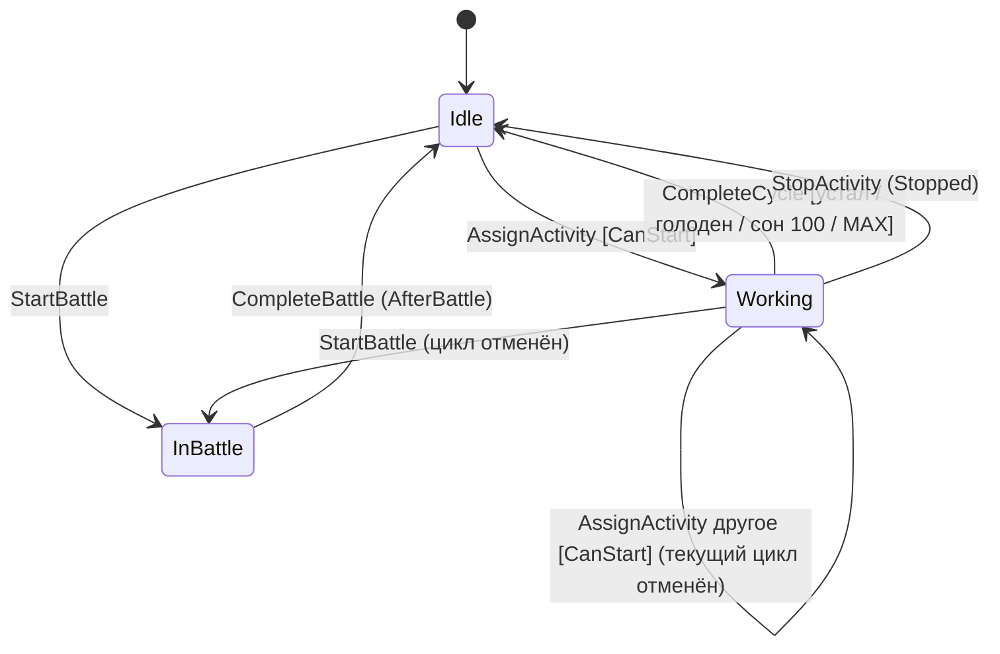
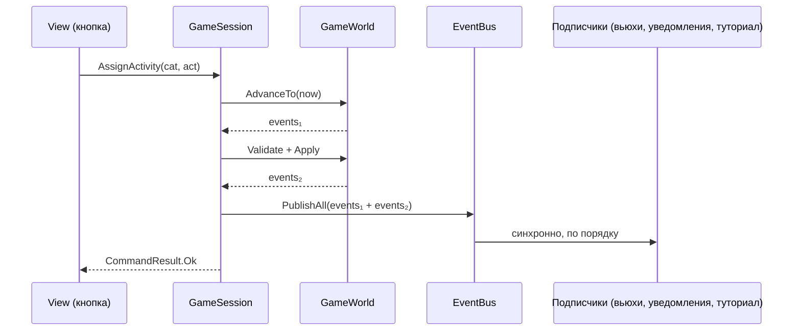
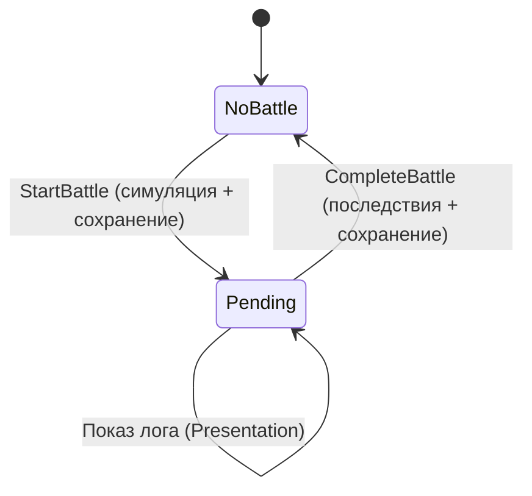
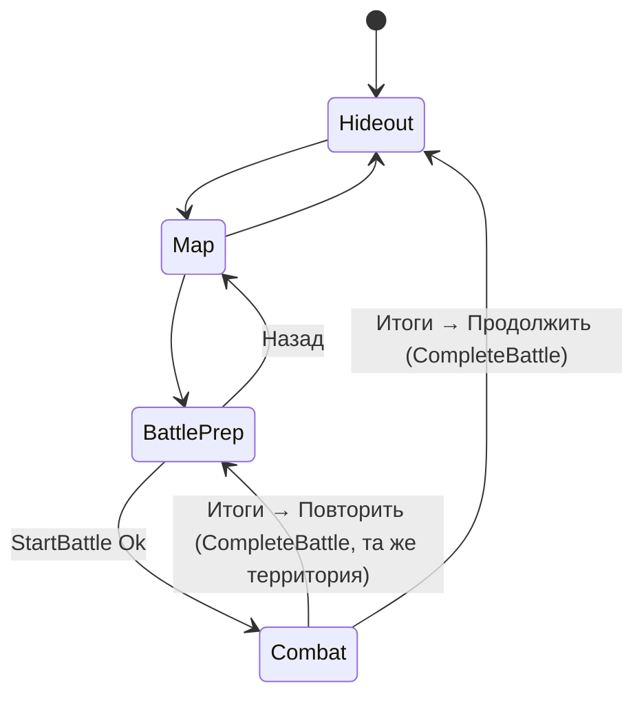

# Trash Cats — Управление состоянием

> Статус: черновик v0.1 (фаза D). Псевдокод — иллюстрация, не production-код.

## 1. Уровни состояния

| Уровень | Владелец | Сохраняется | Пример |
|---|---|---|---|
| **Игровое** | `GameWorld` (Domain) | Да | Занятия котов, ресурсы |
| **Сессионное** | `GameSession`, `NotificationQueue`, `TimeService` (Application) | Нет (кроме `lastUtc` → `SavedAtUtcMs`) | Очередь popup'ов |
| **Экранное** | `ScreenRouter`, вьюхи (Presentation) | Нет | Открытый экран, выбранный кот в листе |
| **Настройки** | `Settings` (часть сохранения) | Да | ×2 боя, громкость |

Правило: экранное состояние всегда можно восстановить из игрового. После перезапуска игрок оказывается в Убежище, кроме случая с `PendingBattle` (см. §5.3).

## 2. Время

```
TimeService.Tick(utcNow):
    realDelta = utcNow - lastUtc
    lastUtc   = utcNow
    if realDelta <= 0: return                         // часы переведены назад или тот же кадр
    delta = min(realDelta, config.OfflineCapMs) * debugTimeScale
    events = Simulation.AdvanceTo(world, world.GameTimeMs + delta)
    bus.PublishAll(events)
    if realDelta >= config.OfflineSummaryMinMs:
        notifications.Enqueue(OfflineSummary.From(events, realDelta, wasCapped: realDelta > cap))
```

- `Tick` вызывается каждый кадр из `GameBootstrap.Update` и один раз при возврате из паузы.
- В обычном кадре `delta` — миллисекунды, обычно завершений нет.
- После загрузки сохранения `lastUtc = SaveData.SavedAtUtcMs`, поэтому первый `Tick` — это офлайн-догон.
- **Почему не `Time.deltaTime`:** он не учитывает время в фоне и зависит от `timeScale`. Единый источник — `IClock.UtcNow`.

## 3. Симуляция занятий

### 3.1. Алгоритм `AdvanceTo`
```
List<DomainEvent> AdvanceTo(world, target):
    events = []
    loop:
        (cat, t) = earliest over cats where Activity is Working: CycleStart + CycleDuration
                   tie-break: cat index in world.Cats
        if cat == null or t > target: break
        world.GameTimeMs = t                         // мир «в моменте» завершения
        events += Activities.CompleteCycle(cat, world)   // стоимость+награда атомарно,
                                                         // затем автоповтор: новый цикл стартует ровно в t
    world.GameTimeMs = target
    return events
```
- Автоповтор начинается **ровно в момент завершения** (`CycleStart = t`), а не в момент следующего кадра. Поэтому онлайн и офлайн дают идентичный результат.
- Сложность: O(число завершений × число котов); за 60 мин офлайна это ≤ ~3 × 240 итераций — пренебрежимо.
- Порядок важен только для общих ресурсов (склад, станции). Еда и Хлам в симуляции лишь прибавляются, станции освобождаются/занимаются тем же котом, поэтому порядок не меняет итог, но фиксируется ради детерминизма.

### 3.2. Автомат занятия кота

Переходы реализуются только внутри `Activities` и `BattleService`. Presentation не может напрямую присвоить состояние.

### 3.3. Решение об автоповторе (псевдокод)
```
CompleteCycle(cat, world):
    def = config.Activity(cat.Activity.ActivityId)
    ApplyCosts(cat, def)                                // обрезка 0..100
    ApplyOutputs(cat, def, world)                       // ресурсы/опыт/энергия с бонусами
    reason = StopReason(cat, def, world)
    if reason == None and (cat.Satiety >= Hungry or cat.Activity.HungryOverride):
        Start(cat, def.Id, world.GameTimeMs, keepOverride: cat.Activity.HungryOverride)
    else:
        cat.Activity = Idle(reason ?? Hungry)
        emit ActivityStopped(cat, reason)

StopReason:
    Sleep:   Energy >= Max            → SleepDone
    Train:   Level == Max             → AttributeMax
    Non-sleep: Energy < Tired         → Tired
    иначе None
```
`HungryOverride = true` выставляется, когда игрок вручную запускает занятие голодному коту (GDD §3.3.5).

## 4. События

### 4.1. Поток


### 4.2. Правила
- Домен не знает о шине: операции **возвращают** списки событий.
- Публикация — только из Application и только после завершения изменения.
- Реентрантность: если подписчик выполняет команду внутри обработчика, её события встают в очередь шины и доставляются после текущей пачки.
- Подписки вьюх оформлены как `IDisposable` и снимаются в `OnDestroy`.

## 5. Бой

### 5.1. Жизненный цикл


### 5.2. Почему результат фиксируется до показа
- Нет эксплойта «закрыть приложение, если проигрываю»: результат уже в сохранении.
- Пропуск и ×2 — просто другой способ проиграть тот же лог.
- Мир продолжает тикать во время показа (остальные коты работают), и бой не конфликтует с симуляцией: участники в `InBattle` выключены из `AdvanceTo`.

### 5.3. Перезапуск при `PendingBattle`
Boot видит `PendingBattle ≠ null` → после загрузки Game-сцены роутер сразу открывает **окно итогов** (без повторного показа боя) → «Продолжить» → `CompleteBattle`.

### 5.4. Проигрывание (Presentation)
```
async UniTask BattlePlayer.Play(BattleView view, CancellationToken ct):
    foreach evt in view.Log:
        await WaitUntilTick(evt.Tick, speed)          // 100 мс / 50 мс за тик
        await arena.Present(evt, speed, ct)           // анимация, цифры, плашки; не дольше бюджета тика
    await arena.PlayOutcome(view.Outcome)
    router.ShowModal(Results)

Skip(): отменить ct → arena.SnapToFinalState(view) → Results
```
Анимации подстраиваются под лог (ускоряются, если не успевают), лог никогда не ждёт анимацию дольше бюджета. Если анимация длиннее, она обрезается.

## 6. UI-навигация

### 6.1. ScreenRouter
```
Screens: Hideout | Map | BattlePrep(territoryId) | Combat
Layers:  Screen (один активный) → Sheet (0..1) → Modal (0..1, из очереди) → Toasts → TutorialOverlay

Navigate(screen):   скрыть текущий корень, показать новый (DOTween fade 0.15 с), закрыть Sheet
OpenSheet(sheet):   поверх экрана; тап вне — закрыть
ShowNextModal():    если Modal пуст и очередь не приостановлена → взять из NotificationQueue
Back():             Tutorial? нет : Modal? закрыть : Sheet? закрыть : экранная логика (UI_UX §3)
```

### 6.2. Автомат экранов

- Во время `Combat` модальные уведомления приостановлены и копятся до окна итогов.
- Если во время Подготовки кот стал недоступен (ушёл спать по автоповтору и т.п.), экран перепроверяет `CanJoinBattle` при событиях и при нажатии «В бой!» — финальная проверка всё равно в команде.

## 7. Туториал
- Состояние — `TutorialState` в мире (пройденные шаги, флаг пропуска).
- `TutorialService` слушает события и решает, какой шаг активен. Overlay показывает выделение по `TargetKey` (вьюхи регистрируют свои RectTransform в `TutorialTargetRegistry` по ключу).
- Во время ведущей цепочки `ScreenRouter` блокирует ввод вне выделенного элемента.

## 8. Пауза и фон приложения

| Событие Unity | Действие |
|---|---|
| `OnApplicationPause(true)` | `SaveService.SaveNow()`; остановить проигрывание звука |
| `OnApplicationPause(false)` | `TimeService.Tick(now)` → возможная сводка |
| `OnApplicationFocus(false)` | Ничего (на Android приходит часто) |
| `OnApplicationQuit` | `SaveService.SaveNow()` |
| Убийство процесса ОС | Потеря максимум последних ≤ 30 с (автосейв) — допустимо |

Во время показа боя пауза приложения не меняет результат. При возврате бой продолжает проигрываться с того же места (или пользователь пропускает).
