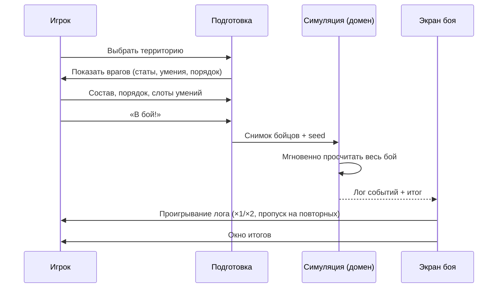

# Trash Cats — Дизайн боя

> Статус: черновик GDD v0.1. Обозначения: ✅ подтверждено, 🔶 стартовое значение, 🧪 требует плейтеста.
> **Бой не реализуется, пока этот документ не будет утверждён отдельно.**

## 1. Ключевые решения ✅
- **Эстафета 1v1.** Каждая сторона выставляет очередь бойцов (до 3). На ринге всегда один на один. Проигравший выбывает, победитель остаётся с текущим HP и Задором, против него выходит следующий.
- **Полностью автоматический бой.** Игрок влияет только на подготовку: состав, порядок, умения в 3 слотах.
- **Скорость ×2** доступна всегда ✅.
- Умения открываются **порогами атрибутов** у каждого кота отдельно ✅.

## 2. Поток боя



Бой **просчитывается целиком до начала показа** 🔶. Экран боя только проигрывает лог событий. Отсюда детерминизм, тестируемость, мгновенный «Пропустить» и отсутствие влияния FPS/сворачивания на результат.

## 3. Модель времени

| Параметр | Значение |
|---|---|
| Тик симуляции | 0.1 с «боевого времени» 🔶 |
| Показ ×1 | 1 тик = 100 мс реального времени |
| Показ ×2 | 1 тик = 50 мс |
| Пауза при выходе нового бойца | 10 тиков (1 с) 🔶 |

### 3.1. Очерёдность действий
- У каждого бойца на ринге есть таймер действия. Когда он доходит до 0, боец действует, и таймер сбрасывается на `ActionInterval`.
- `ActionInterval (тики) = max(10, 16 − floor(Техника / 2))` 🔶. Техника 2 → 1.5 с, Техника 10 → 1.1 с.
- Первое действие после выхода на ринг — через полный `ActionInterval`.
- Если оба действуют в один тик: первым ходит боец с большей Техникой, при равенстве — боец игрока 🔶.

## 4. Производные характеристики и формулы 🔶 🧪

| Характеристика | Формула | Пример (атрибут 2 / 5 / 10) |
|---|---|---|
| Макс. HP | `40 + 12 × Выносливость` | 64 / 100 / 160 |
| Макс. Задор (Grit) | `60`, от атрибутов не зависит (решение 2026-10-15) | 60 |
| Набор Задора | `+5` после каждого своего действия, `+3` за каждый пропущенный удар | — |
| Базовый урон | `4 + 2 × Сила` | 8 / 14 / 24 |
| Интервал действия | `max(10, 16 − floor(Техника/2))` тиков | 1.5 с / 1.4 с / 1.1 с |

- Задор **копится в бою**, как в Punch Club: боец выходит на ринг с 12 Задора и набирает его действиями и пропущенными ударами. Между дуэлями эстафеты HP и Задор **не восстанавливаются** — победитель уходит в следующую дуэль «заведённым». Баланс проверен ботами: медиана прохождения 40 мин, как до изменения.

### 4.1. Попадание
```
HitChance = clamp(0.75 + 0.04 × (Техника_атакующего − Техника_защитника) + МодификаторыУмений, 0.35, 0.95)
```
- Бросок — детерминированный ГСЧ боя.
- Промах показывается как «Мимо!» над защитником (визуально — уклонение защитника).

### 4.2. Урон
```
Урон = max(1, round(БазовыйУрон × МножительУмения × Разброс × Защита × ВнезапнаяСмерть))
Разброс        = случайно в [0.85, 1.15]
Защита         = 0.6, если активна Густая шерсть, иначе 1.0
ВнезапнаяСмерть = 2.0 после 45 с дуэли, иначе 1.0
```

### 4.3. Внезапная смерть 🔶
Если дуэль (не весь бой) длится больше 450 тиков (45 с), весь урон удваивается, на экране появляется плашка «Ярость!». Это гарантирует конец боя без отдельных правил ничьей.

## 5. Умения

### 5.1. Таблица умений (✅ состав, 🔶 числа)

| Умение | Открытие | Задор | Перезарядка* | Эффект |
|---|---|---|---|---|
| **Царапина** (Scratch) | Всегда, не занимает слот | 0 | 0 | Урон ×1.0 |
| **Укус** (Bite) | Сила 4 | 12 | 3 | Урон ×2.0, точность −10 п.п. |
| **Двойная лапа** (Double Paw) | Техника 4 | 10 | 2 | Два удара по ×0.7, каждый бросается отдельно |
| **Густая шерсть** (Thick Fur) | Выносливость 4 | 10 | 5 | Следующие 3 **попавших** по себе удара: урон ×0.6 |
| **Уворот** (Dodge) | Техника 7 | 8 | 4 | Следующая атака врага гарантированно промахивается (Двойная лапа — целиком) |
| **Грязный трюк** (Dirty Trick) | Сила 7 | 12 | 6 | Следующие 3 действия врага: точность −20 п.п. |

\* Перезарядка — в **собственных действиях** бойца. Например, 3 = «доступно снова через 3 своих действия».

- Использование любого умения **занимает ход** бойца. Защитные умения — это отказ от атаки, а не бесплатный бонус.
- Эффекты не складываются сами с собой: повторное применение обновляет счётчик, но ИИ так не делает.
- При выходе нового бойца в эстафете все баффы и дебаффы на ринге снимаются, перезарядки обоих бойцов сбрасываются 🔶.

### 5.2. Почему Уворот и Грязный трюк не дублируют друг друга
| | Уворот | Грязный трюк |
|---|---|---|
| Против чего | Одной **тяжёлой** атаки (Укус) | **Частых** атак (Двойная лапа, быстрые враги) |
| Надёжность | 100%, один раз | −20 п.п. на 3 действия |
| Кому подходит | Техничному коту против силача | Сильному коту против техничного |

Различие сохраняется, только если у врагов есть и тяжёлые, и частые атаки. Отслеживается в [OPEN_QUESTIONS.md](OPEN_QUESTIONS.md).

### 5.3. Слоты ✅
- 3 слота на кота. Царапина есть всегда и слот не занимает.
- Игрок выбирает умения в карточке кота или на экране подготовки.
- Новое открытое умение автоматически встаёт в свободный слот, если он есть 🔶.
- Порядок умений в слотах **не влияет** на поведение: ИИ использует фиксированный приоритет (§6) 🔶. Это сознательное упрощение: игрок решает «что взять», а не программирует ИИ.

## 6. ИИ бойца 🔶

Один и тот же ИИ у котов игрока и у врагов. На каждом своём действии боец выбирает **первое подходящее** правило:

| # | Условие | Действие |
|---|---|---|
| 1 | Есть Густая шерсть, она готова, HP ≤ 60% и шерсть не активна | Густая шерсть |
| 2 | Есть Уворот, он готов, Уворот не активен и у врага готов Укус (в слоте, перезарядка 0, Задора хватает) | Уворот |
| 3 | Есть Грязный трюк, он готов и не активен на враге | Грязный трюк |
| 4 | Укус готов | Укус |
| 5 | Двойная лапа готова | Двойная лапа |
| 6 | — | Царапина |

«Готово» = умение в слоте, перезарядка 0, Задора ≥ стоимости.

Цель всегда одна — противник на ринге. Отдельной логики выбора цели нет: это плюс формата эстафеты.

## 7. Эстафета

### 7.1. Правила
1. Обе стороны выставляют упорядоченную очередь. Враги — фиксированная очередь территории; игрок — 1–3 кота в выбранном порядке.
2. На ринг выходят первые из очередей.
3. Если HP бойца ≤ 0, он **выбывает** (нокаут). Следующий из его очереди выходит после паузы 1 с.
4. Победитель дуэли остаётся с текущими HP и Задором. Баффы, дебаффы и перезарядки сбрасываются, таймер действия перезапускается.
5. Бой окончен, когда у одной стороны закончились бойцы.

### 7.2. Пример решения о порядке
Враг — Енот (сильный, Укус) и Мопс (толстый, Густая шерсть).
- **Порядок А:** Пончик → Рыжий. Пончик держит удары Енота и, скорее всего, проиграет, но снимет ему ~70% HP. Рыжий добивает Енота и выходит против свежего Мопса уже потрёпанным.
- **Порядок Б:** Рыжий → Пончик. Рыжий быстро убивает Енота с запасом HP. Пончик затем выходит против Мопса, у которого тоже Густая шерсть, — долгая дуэль, риск «Ярости».
Правильный ответ зависит от статов, и игрок видит последствия в логе боя. Это и есть основное тактическое решение.

## 8. Подготовка к бою ✅ / 🔶

**Вход:**
- Территория открыта (захвачена или следующая по очереди).
- В бой можно взять кота с Энергией ≥ 20 🔶, в любом состоянии кроме `InBattle`.
- Если кот занят, после «В бой!» появляется подтверждение отмены занятия ✅.

**Игрок видит:**
- Очередь врагов: портрет, уровни атрибутов, умения (полная информация, как в Punch Club 🔶).
- Своих котов: атрибуты, HP/Задор, умения в слотах, Энергию; можно менять слоты прямо здесь.
- Порядок выставляется перетаскиванием или тапами «1-2-3».

**Как решения до боя влияют на результат:**
| Решение | Влияние |
|---|---|
| Какие атрибуты тренировать | Статы; пороги открывают умения |
| Какие умения в слотах | Набор действий ИИ (контр-умения против конкретного врага) |
| Порядок выхода | Кто изматывает, кто добивает |
| Сколько котов взять | Больше котов — больше шансов, но всех взятых ждёт цена после боя |

## 9. Итоги боя ✅ / 🔶

«Участник» — кот, который **выходил на ринг**. Коты из очереди, до которых дело не дошло, ничего не теряют и не получают.

| Итог | Энергия участника | Сытость участника | Опыт участника | Ресурсы |
|---|---|---|---|---|
| **Победа** | −30 (не ниже 0) 🔶 | −10 🔶 | +8 к каждому атрибуту 🔶 | Награда территории (первая / повторная) |
| **Поражение** | = 0 ✅ | −10 🔶 | +3 к каждому атрибуту ✅/🔶 | — |

- Первая победа: территория захвачена, применяется пассивный бонус, может прийти новый кот (см. [PROGRESSION_AND_ECONOMY.md](PROGRESSION_AND_ECONOMY.md)).
- После боя все коты из состава становятся `Idle`.
- Повторные бои на захваченной территории дают 30% награды 🔶. Вербовка и бонус не повторяются.

## 10. Детерминизм и тестируемость
- Seed боя = хэш(`SaveSeed`, `TerritoryId`, `AttemptIndex`) 🔶. Перезапуск приложения посреди показа боя приводит к тому же результату: бой засчитывается в момент «В бой!» (см. [OPEN_QUESTIONS.md](OPEN_QUESTIONS.md#c-бой)).
- Собственный ГСЧ домена (не `UnityEngine.Random`).
- Одинаковые (снимок бойцов, seed) всегда дают одинаковый лог.
- **Балансный симулятор**: офлайн-тест (Edit Mode), который прогоняет каждую территорию против «ожидаемого состава игрока» на 1000 seed и выводит шанс победы. Целевые коридоры — в [PROGRESSION_AND_ECONOMY.md](PROGRESSION_AND_ECONOMY.md).

## 11. Обратная связь в бою (Presentation)

| Событие лога | Отображение |
|---|---|
| `Attack(hit, dmg)` | Анимация атаки, всплывающая цифра урона, тряска защитника |
| `Attack(miss)` | Анимация атаки, защитник уворачивается, «Мимо!» |
| `SkillUsed` | Плашка с названием умения над бойцом (Укус! / Густая шерсть!) |
| `BuffApplied/Expired` | Иконка над полосой HP, счётчик зарядов |
| `KO` | Анимация нокаута, боец уходит с ринга |
| `FighterEnter` | Выход нового бойца, обновление очередей сверху |
| `SuddenDeath` | Плашка «Ярость!», красная виньетка |
| `BattleEnd` | Победная/проигрышная поза → окно итогов |

Полосы HP и Задора под каждым бойцом. Очередь бойцов — иконки сверху экрана, выбывшие перечёркнуты.

## 12. Пример расчёта (первый бой) 🔶

Рыжий (СИЛ 4, ТЕХ 2, ВЫН 2, Укус) против Крысы (СИЛ 2, ТЕХ 3, ВЫН 1, без умений).

| | Рыжий | Крыса |
|---|---|---|
| HP | 64 | 52 |
| Урон Царапиной | 12 | 8 |
| Интервал | 1.5 с | 1.5 с |
| Шанс попадания | 71% (Укус 61%) | 79% |

Ожидаемый урон Рыжего за действие ≈ 10, Крыса падает примерно за 5–6 действий (~8 с). За это время Крыса наносит ~32 урона, и Рыжий заканчивает бой примерно с 50% HP.
**Без тренировки** (СИЛ 3, без Укуса) Рыжий побеждает примерно с 15–25% HP, и при неудачных бросках возможно поражение. Это сознательный урок первого боя: «одна тренировка заметно помогает» 🧪.
