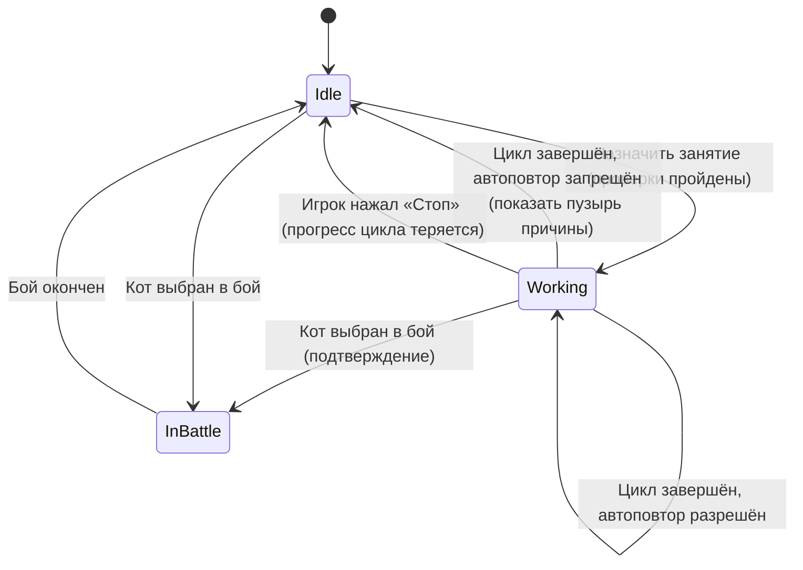
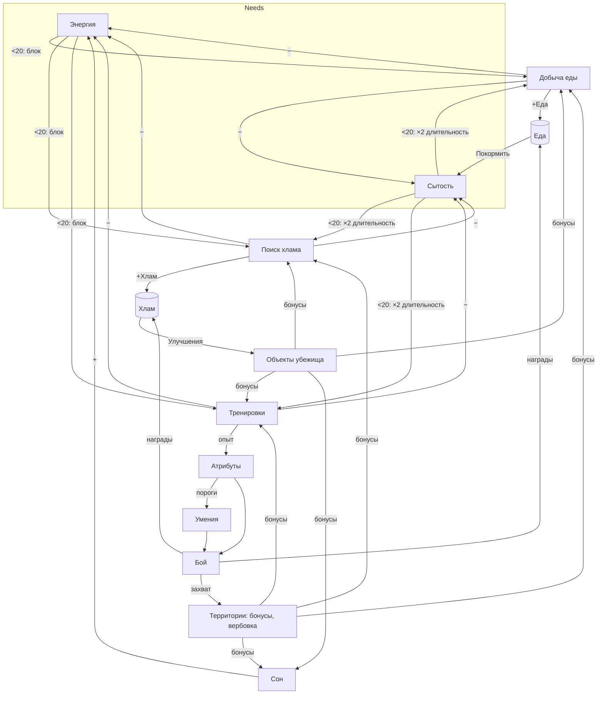

# Trash Cats — Основные системы

> Статус: черновик GDD v0.1. Обозначения: ✅ подтверждено, 🔶 стартовое значение, 🧪 требует плейтеста.
> Все числа балансировки собраны в одном месте в [PROGRESSION_AND_ECONOMY.md](PROGRESSION_AND_ECONOMY.md#сводная-таблица-параметров). Здесь они приводятся для понятности правил.

## 1. Коты

### 1.1. Данные кота

| Поле | Тип | Описание |
|---|---|---|
| `Id` | string | Стабильный идентификатор (`cat_ryzhy`, `cat_shnyr`, `cat_ponchik`) |
| `DefinitionId` | string | Ссылка на статическое описание (имя, склонность, внешний вид, стартовые статы) |
| `Attributes` | Сила / Ловкость / Крепость | Каждый: `Level` (1–10) и `Xp` (накоплено к следующему уровню) |
| `Energy` | int 0–100 | Потребность |
| `Satiety` | int 0–100 | Потребность |
| `EquippedSkills` | до 3 id | Слоты умений (Царапина не занимает слот) |
| `Activity` | состояние | Текущее занятие (см. §3) |
| `IsRecruited` | bool | Есть ли кот в банде |

### 1.2. Склонность (Aptitude) ✅
- У каждого кота ровно один «любимый» атрибут.
- Тренировка этого атрибута даёт **+50% опыта** ✅ (бонус складывается с бонусами станции, см. §5.3).
- Стартовые уровни смещены в сторону склонности.
- Тренировать можно любой атрибут — склонность не запрещает, а поощряет.

### 1.3. Ростер ✅ (значения статов 🔶)

| Кот | Склонность | Как получить | Старт: СИЛ / ЛОВ / КРП |
|---|---|---|---|
| **Рыжий** — драчун со шрамом | Сила | Стартовый | 3 / 2 / 2 |
| **Шнырь** — тощий юркий воришка | Ловкость | Победа на Заднем дворе | 3 / 5 / 3 |
| **Пончик** — огромный ленивый толстяк | Крепость | Победа в Тёмном переулке | 5 / 4 / 7 |

Поздние коты приходят с более высокими статами, чтобы сразу быть полезными в боях (🧪).

### 1.4. Атрибуты ✅

| Атрибут | В бою влияет на | Тренировка |
|---|---|---|
| **Сила** (Strength) | Урон всех атак | Бить консервную банку |
| **Ловкость** (Agility) | Точность, уклонение, скорость действий | Ловить заводную мышь |
| **Крепость** (Toughness) | HP, запас и восстановление Задора | Бегать в колесе |

- Уровни 1–10 🔶. Опыт сверх уровня 10 не начисляется, станция показывает «MAX».
- Атрибуты **не снижаются** никогда ✅.
- Повышение уровня проверяется сразу после начисления опыта; за одно начисление можно получить несколько уровней (опыт переносится).
- Достижение порога открывает умение (см. [COMBAT_DESIGN.md](COMBAT_DESIGN.md#5-умения)) — popup «Новое умение!».

## 2. Потребности ✅

### 2.1. Энергия — «ограничитель по времени»
- Диапазон 0–100.
- **Тратится** при завершении цикла Добычи еды, Поиска хлама и тренировки, а также после боя.
- **Восстанавливается** только Сном (занимает время, еду не тратит).
- **Порог 20** ✅: при Энергии < 20 нельзя *начать* цикл Добычи, Поиска хлама и тренировки. Сон доступен всегда.
- Для участия в бою нужно Энергии ≥ 20 🔶.

### 2.2. Сытость — «ограничитель по еде»
- Диапазон 0–100.
- **Тратится** при завершении цикла занятий (кроме Сна) и после боя.
- **Восстанавливается** мгновенно кнопкой «Покормить»: 1 Еда = +10 Сытости 🔶.
- **Порог 20** ✅: при Сытости < 20 кот **голоден** — длительность циклов Добычи, Поиска хлама и тренировок ×2 ✅.
- Голодный кот **может** начинать любые занятия (страховка от тупика ✅). Автоповтор при этом останавливается (см. §3.3), а ручной запуск разрешён.
- **Пассивного расхода нет** 🔶: потребности меняются только от действий. Поэтому кот не может умереть или «испортиться», пока игра закрыта.
- Сытость **не влияет** на бой 🔶.

### 2.3. Почему две потребности не дублируют друг друга
| | Энергия | Сытость |
|---|---|---|
| Чем «платит» игрок | **Временем** (сон) | **Ресурсом** (еда) |
| Что будет, если её не восстанавливать | Кот **не может** работать | Кот работает **вдвое медленнее** |
| Решение | «Когда класть спать» | «Сколько котов держать на добыче еды» |

## 3. Занятия и планировщик

### 3.1. Список занятий

| Занятие | Где | Вместимость | Длит. 🔶 | Энергия 🔶 | Сытость 🔶 | Результат 🔶 |
|---|---|---|---|---|---|---|
| **Добыча еды** (Scavenge) | За кадром (уходит за угол) | Без лимита ✅ | 20 с | −10 | −4 | +3 Еды |
| **Поиск хлама** (Rummage) | Мусорный бак | Без лимита ✅ | 25 с | −10 | −4 | +3 Хлама |
| **Тренировка Силы** | Банка | **1 кот** ✅ | 30 с | −15 | −10 | +10 опыта Силы |
| **Тренировка Ловкости** | Мышь | **1 кот** ✅ | 30 с | −15 | −10 | +10 опыта Ловкости |
| **Тренировка Крепости** | Колесо | **1 кот** ✅ | 30 с | −15 | −10 | +10 опыта Крепости |
| **Сон** | Коробки | Без лимита ✅ | 15 с | +25 | 0 | — |
| **Покормить** | Мгновенно | — | 0 | — | до 100 | −1 Еда за каждые 10 Сытости |

### 3.2. Состояния занятия кота



- `Idle` — свободен. Пузырь над головой показывает причину остановки: 💤 «Устал», 🍗 «Голоден», ✔ «Готово» (Сон до 100).
- `Working` — хранит `ActivityId`, `CycleStartTime`, `CycleDuration` (с учётом голода и бонусов, фиксируется на старте цикла).
- `InBattle` — кот на экране боя, занятия недоступны.

### 3.3. Правила цикла ✅ / 🔶
1. **Проверка при старте цикла** (ручном и автоповторе):
   - Кот не в бою.
   - Для Добычи, Поиска хлама и тренировок: Энергия ≥ 20.
   - Для тренировок: станция свободна (или занята этим же котом) и атрибут < 10.
   - Для Сна: Энергия < 100.
2. **Длительность фиксируется на старте цикла:** база × (2, если голоден) × модификаторы. Если кот поел посреди цикла, текущий цикл не ускоряется 🔶. Так проще и предсказуемее.
3. **Стоимость и награда применяются при завершении цикла**, атомарно, одним событием. Стоимость не может опустить потребность ниже 0 (обрезка).
4. **Отмена** («Стоп» или взятие в бой) — цикл не завершается: ни стоимость, ни награда не применяются, прогресс теряется ✅.
5. **Автоповтор** ✅: после завершения цикла кот сразу начинает следующий, если проверки §3.3.1 пройдены **и** Сытость ≥ 20. Иначе — `Idle` с пузырём.
   - Сон автоповторяется до Энергии 100, затем `Idle` (✔).
   - Голодный кот, запущенный вручную, повторяет занятие, пока Энергия ≥ 20 (игрок уже согласился на медленный режим) 🔶.
6. **Станции** освобождаются в момент завершения цикла без автоповтора или при отмене.

### 3.4. Время ✅
- Реальное время, источник — системные UTC-часы устройства.
- Игра идёт, пока приложение открыто. На паузе (сворачивание) — сохраняемся.
- **Офлайн-прогресс** ✅: при возврате прошедшее время ограничивается **60 минутами** 🔶 и симулируется по тем же правилам (циклы, автоповтор, пороги). Еда и Хлам только *прибавляются* офлайн (кормление вручную), поэтому коты независимы, и симуляция детерминирована.
- После офлайн-симуляции показывается **сводка «Пока тебя не было»**: +Еда, +Хлам, полученные уровни, кто остановился и почему.
- Если часы устройства переведены назад (прошедшее время < 0) — считаем прошедшее время равным 0, ничего не отнимаем 🔶.
- Время продолжает идти во время боя ✅ (бой занимает ~30–90 с реального времени).

### 3.5. Граничные случаи
| Случай | Поведение |
|---|---|
| Два кота хотят одну станцию | Второму кнопка недоступна с подписью «Занято: Шнырь» |
| Атрибут достиг 10 во время автоповтора | Цикл, который довёл до 10, завершается; повтор не стартует; пузырь «MAX» |
| Еды 0, все голодны | Добыча доступна вручную (×2 длительность) → тупика нет |
| Игрок кормит кота, у которого Сытость 95 | Тратится 1 Еда, Сытость = 100 (округление вверх при расчёте нужной еды) 🔶 |
| Офлайн 3 часа | Симулируется 60 минут, в сводке указано «прогресс ограничен 1 часом» |
| Кот выбран в бой во время цикла | Диалог «Шнырь бросит тренировку (прогресс потерян). Продолжить?» |

## 4. Ресурсы ✅

| Ресурс | Источник | Траты | Лимит |
|---|---|---|---|
| **Еда** | Добыча еды, награды за бои | Только кормление | Нет 🔶 |
| **Хлам** | Поиск хлама, награды за бои | Только улучшения | Нет 🔶 |

- Общий склад банды. Отображаются в HUD всегда.
- Целые числа. Бонусы применяются к базовому выходу и округляются по правилу «половина вверх» 🔶.

## 5. Тренировки

### 5.1. Станции ✅
| Станция | Атрибут | Анимация |
|---|---|---|
| Консервная банка на верёвке | Сила | Кот лупит лапами, банка звенит и раскачивается |
| Заводная мышь | Ловкость | Кот прыгает за мышью по кругу |
| Самодельное колесо (из ведра/шины) | Крепость | Кот бежит в колесе |

### 5.2. Опыт за цикл
```
xp = floor(BaseXp × (1 + AptitudeBonus + StationBonus + TerritoryBonus))
BaseXp = 10 🔶
AptitudeBonus  = 0.5, если атрибут — склонность кота, иначе 0   ✅
StationBonus   = 0 / 0.25 / 0.5 для уровня станции 0 / 1 / 2    🔶
TerritoryBonus = 0.1 после захвата Городского парка              🔶
```
Бонусы складываются, а не перемножаются: так проще считать и объяснять.

Примеры: Рыжий на Банке ур.2 → floor(10 × 2.0) = 20 опыта Силы. Шнырь на Банке ур.0 → 10.

### 5.3. Специализация
Специализацию задают склонность и одна станция на атрибут. Три кота конкурируют за три станции, поэтому естественное решение — «каждый на своей». Неочевидное решение — посадить Пончика на Банку, чтобы открыть ему Укус, если Рыжий спит.

## 6. Сон и кормление

- **Сон:** цикл 15 с, +25 Энергии (Коробки ур.1: +35, ур.2: +45) 🔶. Длительность не меняется — растёт восстановление.
- **Кормление:** кнопка в карточке кота или в быстром действии на панели котов. Съедает `ceil((100 − Сытость) / 10)` Еды или всю доступную, если её меньше. Анимация еды ~1 с, но не блокирует назначение занятий.
- Кормление возможно в любом состоянии, кроме `InBattle` (даже во время цикла — цикл продолжается).

## 7. Улучшения убежища ✅ (стоимость и эффекты 🔶 🧪)

| Объект | Ур.1 | Ур.2 | Эффект ур.0 → 1 → 2 |
|---|---|---|---|
| **Коробки** | 15 Хлама | 40 Хлама | Сон: +25 → +35 → +45 Энергии за цикл |
| **Мусорный бак** | 15 Хлама | 40 Хлама | Добыча: 3 → 4 → 5 Еды; Поиск хлама: 3 → 4 → 5 Хлама |
| **Банка** | 15 Хлама | 40 Хлама | +0 / +25% / +50% опыта Силы |
| **Мышь** | 15 Хлама | 40 Хлама | +0 / +25% / +50% опыта Ловкости |
| **Колесо** | 15 Хлама | 40 Хлама | +0 / +25% / +50% опыта Крепости |

- Покупка мгновенная: тап по объекту → панель «Улучшить за N Хлама» → визуальная смена объекта + popup.
- Бонус улучшения применяется к результату цикла **в момент его завершения** — купленное посреди цикла улучшение уже влияет на текущий цикл. (Изменено 2026-10-13 при реализации M1: так не нужно хранить «снимок» бонусов в сохранении, а игрок сразу видит эффект покупки. Длительность цикла по-прежнему фиксируется на старте — §3.3.2.)
- Всего 10 улучшений, 275 Хлама. За прохождение ожидается ~140–160 Хлама (см. экономику), то есть игрок **не купит всё** — выбор осмысленный 🧪.

## 8. Взаимодействие систем



## 9. Как это будет тестироваться (дизайн-уровень)
- Юнит-тесты правил цикла: старт, завершение, отмена, автоповтор, пороги, голод ×2, атомарность наград.
- Тест офлайн-симуляции: «закрыли игру на N минут» = «игра была открыта N минут» (одинаковое итоговое состояние при отсутствии ручных действий).
- Тест на отсутствие тупика: из любого состояния с Еда = 0 существует последовательность действий, ведущая к росту Еды.
- Подробно — в архитектурной фазе (Docs/Architecture).
