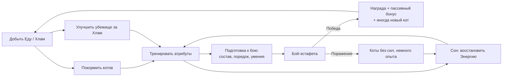

# Trash Cats — Обзор игры

> Статус: черновик GDD v0.1 (фаза C). Основано на «Сводке решений», утверждённой 2026-10-12.
>
> Обозначения статуса значений во всех документах GDD:
> - ✅ **Подтверждено** — решение принято пользователем.
> - 🔶 **Стартовое значение** — предложено дизайнером, принято как отправная точка.
> - 🧪 **Требует плейтеста** — значение заведомо будет меняться по результатам тестов.

## 1. High Concept

Банда бродячих котов за рестораном. Игрок управляет до трёх котами одновременно: добывает еду и хлам, тренирует, кормит и укладывает спать, улучшает убежище и готовит котов к автоматическим боям-эстафетам с соперниками за соседние территории. Цель — стать главной бандой района, победив босса на крыше ресторана.

**Одна фраза:** «Punch Club на троих котов, сжатый до 40 минут».

## 2. Жанр и референсы

| | |
|---|---|
| Жанр | Менеджмент / лёгкая RPG / авто-баттлер |
| Платформа | Android, iOS. Портрет, референс 1080×1920 |
| Движок | Unity 6 (6000.0.x) |
| Главный референс | **Punch Club** — тренировки, потребности, автоматические бои с подготовкой умений |
| Вторичные | **Kairosoft**-игры (читаемая сцена «база с занятыми персонажами»), **Neko Atsume** (тон и котики), **Auto-battler**'ы (решения до боя) |

Отличия от Punch Club: банда вместо одного героя, бои-эстафеты вместо дуэлей, реальное время вместо дней, нет деградации статов, нет сюжета.

## 3. Целевая аудитория

- Мобильные игроки 18–35, любители idle/management и «котиков».
- Сессии 5–15 минут в обычной игре; прототип целиком проходится за один заход 30–45 минут ✅.
- Игрок, которому нравится планировать и оптимизировать, но не нравится микроконтроль в бою.

## 4. Фантазия игрока

«Я — вожак маленькой уличной банды. Мои коты разные: рыжий драчун, юркий шнырь и толстый непробиваемый пончик. Я решаю, кто роется в мусоре, кто качается на консервной банке, а кто выходит первым против енота. Когда план срабатывает — это моя победа».

## 5. Core Loop

**Микро-цикл (30–60 с):** назначить занятие → увидеть прогресс → получить результат → переназначить, когда кот устал или проголодался.

**Мезо-цикл (5–8 мин):** накопить статы и хлам → улучшение → подготовить бой → захватить территорию.

**Макро-цикл (весь прототип):** 5 боевых территорий → босс на крыше → финальный экран.

## 6. Ключевые решения игрока (примеры)

| Ситуация | Решение | Последствие |
|---|---|---|
| У Рыжего 25 Энергии, у Шныря 90 | Кого отправить на тренировку, кого — в мусор за хламом? | Тренировка даёт статы сейчас, хлам — улучшение тренажёра позже |
| Есть 15 Хлама | Улучшить Банку (Сила) или Коробки (сон)? | Банка ускоряет главного бойца; Коробки ускоряют всю банду |
| Враг — енот с Укусом | Поставить Уворот в слот вместо Двойной лапы? | Меньше урона по врагу, но избегаем самого тяжёлого удара |
| Против босса | Первым — Пончик (танк) или Рыжий (урон)? | Танк изматывает босса, но тратит время; урон сразу, но рискуем потерять лучшего бойца |
| Шнырь тренируется, бой важен | Снять его с занятия (потеря текущего цикла)? | Сильнее состав vs. потеря ~30 с прогресса |

## 7. Design Pillars

1. **Просто выучить, интересно оптимизировать.** Мало систем, каждая с реальной ценой.
2. **Ресурсное напряжение в духе Punch Club.** Время (Энергия), еда (Сытость), хлам (улучшения) — три разных ограничителя.
3. **Управление бандой.** До 3 котов работают параллельно; тренажёры — общий дефицитный ресурс.
4. **Автоматический бой.** Игрок решает до боя: кто, в каком порядке, с какими умениями.
5. **Короткие сессии.** Значимый результат каждые 15–45 секунд.
6. **Сильная визуальная обратная связь.** Каждое занятие и умение имеет узнаваемую анимацию.
7. **Маленький, тестируемый скоуп.** Если фича не усиливает цикл — её нет.

## 8. Скоуп прототипа

### Входит ✅
- 3 играбельных кота со склонностями (1 стартовый + 2 вербуемых).
- 3 атрибута (Сила, Ловкость, Выносливость), 2 потребности (Энергия, Сытость).
- 6 занятий: Добыча еды, Поиск хлама, 3 тренировки, Сон. Кормление — мгновенное действие.
- 2 ресурса: Еда, Хлам.
- 5 улучшаемых объектов × 2 уровня.
- Бой-эстафета 1v1, 6 умений (Царапина + 5 открываемых), 3 слота.
- 6 локаций: убежище + 5 боевых территорий (последняя — босс).
- Офлайн-прогресс с лимитом ~1 час.
- Подсказки-онбординг.
- Сохранение/загрузка локально.

### Не входит (non-goals) ✅
Мультиплеер/PvP, сюжетная кампания, диалоговая система, разведение, экипировка и инвентарь, сложные валюты, процедурная генерация, крафт, деревья талантов, травмы и болезни, старение, деградация статов, настроение, монетизация и реклама, LiveOps, бэкенд, смена дня и ночи, свободное строительство базы.

## 9. Цели валидации прототипа 🔶

Прототип считается успешным, если на плейтесте (5–10 человек, без подсказок от разработчика):

| # | Критерий | Как измеряем |
|---|---|---|
| 1 | Игрок доходит до босса за 30–45 минут и **ни разу не застревает** без доступного осмысленного действия | Телеметрия времени + наблюдение |
| 2 | После поражения игрок может **объяснить причину** (умения / порядок / статы) | Опрос после сессии |
| 3 | Игроки **меняют набор умений или порядок** между разными боями | Лог изменений слотов/порядка |
| 4 | Хотя бы раз игрок **осознанно распределяет котов** между едой, хламом и тренировкой | Наблюдение, опрос |
| 5 | >50% тестеров **хотят продолжить** после финала | Опрос |

Провал критериев 3–4 означает, что основное предположение («управлять бандой интересно») не подтверждено, и это важнее любых проблем баланса.

## 10. Связанные документы

- [CORE_SYSTEMS.md](CORE_SYSTEMS.md) — коты, потребности, занятия, ресурсы, улучшения.
- [COMBAT_DESIGN.md](COMBAT_DESIGN.md) — бой-эстафета, формулы, умения, ИИ.
- [PROGRESSION_AND_ECONOMY.md](PROGRESSION_AND_ECONOMY.md) — экономика, кривые, награды, пример прохождения.
- [UI_UX.md](UI_UX.md) — экраны, навигация, вайрфреймы.
- [CONTENT_SPEC.md](CONTENT_SPEC.md) — список контента, анимации, VFX/SFX.
- [OPEN_QUESTIONS.md](OPEN_QUESTIONS.md) — открытые вопросы и риски.
