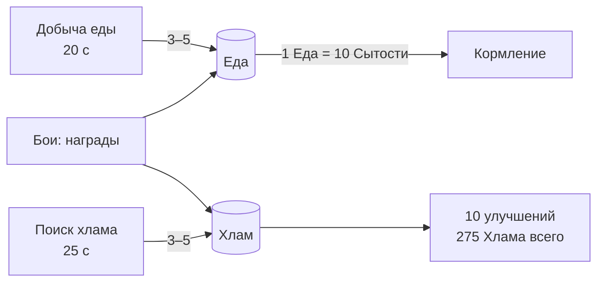

# Trash Cats — Прогрессия и экономика

> Статус: черновик GDD v0.1. Обозначения: ✅ подтверждено, 🔶 стартовое значение, 🧪 требует плейтеста.
> **Почти все числа здесь — 🔶/🧪.** Подтверждены только структурные решения: два ресурса, порядок вербовки, награда + бонус за территорию, 5 улучшений по 2 уровня.

## 1. Источники и стоки ресурсов

| Ресурс | Источники | Стоки | Роль в дизайне |
|---|---|---|---|
| Еда | Добыча (~55%), бои (~45%) 🧪 | Только кормление | «Налог» на активность: сколько времени банды уходит на пропитание |
| Хлам | Поиск хлама (~45%), бои (~55%) 🧪 | Только улучшения | Инвестиции: что ускорить в первую очередь |

**Старт:** 10 Еды, 0 Хлама 🔶.

## 2. Прогрессия атрибутов

### 2.1. Кривая опыта 🔶
Опыт для перехода с уровня L на L+1: **`XpToNext(L) = 10 + 12 × (L − 1)`** (было 7 — изменено 2026-10-13 по боту экономики, всего 1→10 = 522).

| Уровень | 1→2 | 2→3 | 3→4 | 4→5 | 5→6 | 6→7 | 7→8 | 8→9 | 9→10 | Всего 1→10 |
|---|---|---|---|---|---|---|---|---|---|---|
| Опыт | 10 | 17 | 24 | 31 | 38 | 45 | 52 | 59 | 66 | **342** |
| Циклов при 10 / 15 / 20 опыта | 1/1/1 | 2/2/1 | 3/2/2 | 4/3/2 | 4/3/2 | 5/3/3 | 6/4/3 | 6/4/3 | 7/5/4 | 34/23/18 |

Рост линейный, без экспоненты: в 40-минутном прототипе экспонента сделала бы последние уровни недостижимыми.

### 2.2. Источники опыта
| Источник | Опыт |
|---|---|
| Цикл тренировки | `floor(10 × (1 + склонность 0.5 + станция 0/0.25/0.5 + парк 0.1))` |
| Победа в бою (участник) | +8 к каждому атрибуту |
| Поражение (участник) | +3 к каждому атрибуту |

### 2.3. Пороги умений ✅ (значения 🔶)
| Порог | Умение |
|---|---|
| Сила 4 | Укус |
| Ловкость 4 | Двойная лапа |
| Выносливость 4 | Густая шерсть |
| Ловкость 7 | Уворот |
| Сила 7 | Грязный трюк |

## 3. Вербовка ✅

| Кот | Условие | Стартовые потребности |
|---|---|---|
| Рыжий | Старт | Энергия 100, Сытость 60 |
| Шнырь | Первая победа на **Заднем дворе** | Энергия 100, Сытость 50 |
| Пончик | Первая победа в **Тёмном переулке** | Энергия 100, Сытость 50 |

Кот появляется в убежище сразу после окна итогов, с popup «Новый кот в банде!» и короткой анимацией прихода.

## 4. Территории ✅ (награды и бонусы 🔶)

Открываются строго по очереди: победа на N открывает N+1. Убежище (Мусорка ресторана) — база, боя там нет.

| # | Территория | Враги (очередь) | Первая победа: Еда / Хлам | Пассивный бонус / событие |
|---|---|---|---|---|
| 0 | **Мусорка ресторана** | — (база) | — | — |
| 1 | **Задний двор** | Крыса Хвост | 10 / 10 | **+Шнырь**; «Тихий двор»: Сон +5 Энергии за цикл |
| 2 | **Рыбная лавка** | Чайка → Кот Сёмга | 15 / 15 | «Рыбные объедки»: Добыча еды +25% |
| 3 | **Тёмный переулок** | Ворона → Крыса-громила | 15 / 25 | **+Пончик**; «Склад барахла»: Поиск хлама +25% |
| 4 | **Городской парк** | Ворона-атаман → Енот → Мопс | 20 / 30 | «Спортплощадка»: +10% опыта на всех тренажёрах |
| 5 | **Крыша ресторана** | **Адмирал** (босс) | 40 / 40 | Финальный экран «Главная банда района» |

- **Повторный бой:** 30% от награды первой победы, округление вверх 🔶. Без вербовки и бонусов.
- После финала игра продолжается: можно повторять бои, доучивать котов, докупать улучшения.

### 4.1. Враги 🔶 🧪

| Враг | СИЛ / ЛОВ / КРП | HP | Умения | Роль |
|---|---|---|---|---|
| Крыса Хвост | 2 / 3 / 1 | 52 | — | Обучающий бой |
| Чайка | 3 / 5 / 2 | 64 | Двойная лапа* | Быстрый, частые удары |
| Кот Сёмга | 5 / 3 / 4 | 88 | Укус | Сильный, тяжёлый удар |
| Ворона | 4 / 6 / 3 | 76 | Двойная лапа*, Уворот | Неуловимый |
| Крыса-громила | 5 / 4 / 4 | 88 | Укус, Грязный трюк | Силовой, мешает попадать |
| Ворона-атаман | 5 / 8 / 3 | 76 | Двойная лапа*, Уворот | Улучшенная Ворона |
| Енот | 7 / 5 / 5 | 100 | Укус, Грязный трюк | Универсал |
| Мопс | 5 / 3 / 9 | 148 | Густая шерсть, Укус | Танк |
| **Адмирал** (босс) | 9 / 7 / 10 | 160 × **1.7** = 272 | Укус, Густая шерсть, Грязный трюк | Финальный босс, HP ×1.7 |

\* У птиц умение отображается как «Двойной клевок» — механика та же (только переименование в данных).

## 5. Улучшения убежища

| Объект | Ур.1 | Ур.2 | Эффект |
|---|---|---|---|
| Коробки | 20 | 60 | Сон: +25 → +35 → +45 Энергии |
| Мусорный бак | 20 | 60 | Еда за Добычу 3 → 4 → 5; Хлам за Поиск 3 → 4 → 5 |
| Банка | 20 | 60 | Опыт Силы +0% → +20% → +40% |
| Мышь | 20 | 60 | Опыт Ловкости +0% → +20% → +40% |
| Колесо | 20 | 60 | Опыт Выносливости +0% → +20% → +40% |

**Бюджет хлама за прохождение 🧪:** бои до босса дают 80, Поиск хлама — ~60–80 (≈20 циклов). Итого ~140–160 из 275 возможных: все 5 первых уровней (75) и 1–2 вторых. Так игрок осознанно выбирает приоритет.

**Ожидаемые варианты стратегии:**
- «Сначала сон» — Коробки рано: вся банда работает больше, но медленнее растут статы.
- «Сначала главный боец» — Банка до ур.2: Рыжий быстро растёт, остальные отстают.
- «Сначала экономика» — Бак рано: больше хлама потом, но слабее в ранних боях.

## 6. Кривая сложности 🧪

Цель: первый заход на территорию в «ожидаемое время» выигрывается в **50–70%** случаев, а после ~3 минут подготовки (тренировка, смена умений или порядка) — в **≥80%**. Проверяется балансным симулятором (см. [COMBAT_DESIGN.md](COMBAT_DESIGN.md#10-детерминизм-и-тестируемость)).

| Бой | Ожидаемое время | Ожидаемый состав игрока (СИЛ/ЛОВ/КРП, ключевые умения) |
|---|---|---|
| Задний двор | ~4 мин | Рыжий 4/2/2 (Укус) |
| Рыбная лавка | ~12 мин | Рыжий 6/3/3 (Укус); Шнырь 3/6/3 (Двойная лапа) |
| Тёмный переулок | ~21 мин | Рыжий 7/3/4 (Укус, Шерсть, Трюк); Шнырь 4/7/4 (Двойная лапа, Уворот, Шерсть) |
| Городской парк | ~31 мин | Рыжий 8/4/5; Шнырь 5/8/4; Пончик 6/4/8 |
| Крыша | ~40 мин | Рыжий 9/4/7; Шнырь 5/9/5; Пончик 6/5/10 |

## 7. Пример прохождения 🧪

| Время | Что происходит | Решение игрока |
|---|---|---|
| 0:00 | Подсказки: Рыжий добывает еду → ест → тренирует Силу | Следует подсказкам |
| 1:30 | Сила 4 → «Новое умение: Укус» | — |
| 3:00 | Энергия < 20, Рыжий спит | Первый урок «устал» |
| 4:00 | Бой на Заднем дворе, победа. **Приходит Шнырь** | — |
| 4–12 | Шнырь качает Ловкость, Рыжий чередует Силу и Поиск хлама | **Кто роется в хламе?** |
| ~8:00 | Первое улучшение: Банка ур.1 | **Банка или Коробки?** |
| ~12:00 | Рыбная лавка: Сёмга с Укусом бьёт больно | **Порядок: Шнырь первым против быстрой Чайки?** |
| 12–21 | Шнырь открывает Уворот (ЛОВ 7), Рыжий — Грязный трюк (СИЛ 7) | **Какие 3 умения взять против Вороны?** |
| ~21:00 | Тёмный переулок. Возможно поражение → коты спят, +3 опыта | Перестроить порядок/умения |
| ~22:00 | **Приходит Пончик** — теперь три рта и три станции | **Распределение по станциям** |
| 22–31 | Бак ур.1/Коробки ур.1; копим на ур.2 | Экономика vs статы |
| ~31:00 | Городской парк, бой из трёх дуэлей | Порядок против Мопса-танка |
| 31–40 | Финальная подготовка | **Кто первым против босса?** |
| ~40:00 | Победа над Адмиралом → финальный экран | — |

## 8. Ожидаемая занятость котов 🧪

На одну полосу Энергии (100 → ~10) у кота уходит примерно:
- 6 циклов тренировки (3 мин) → −60 Сытости → 6 Еды → 2 цикла Добычи (40 с, −20 Энергии).
- Сон с 10 до 100: 3–4 цикла (~1 мин).

Получается ~**60% времени — тренировки, ~15% — добыча еды, ~25% — сон**, а Поиск хлама отнимает время у тренировок. Если плейтест покажет, что еда не ощущается как ограничение (меньше 10% времени), поднимаем расход Сытости тренировки с 10 до 12–15.

## Сводная таблица параметров

| Параметр | Значение | Статус |
|---|---|---|
| Энергия / Сытость макс. | 100 / 100 | 🔶 |
| Порог «устал» / «голоден» | 20 / 20 | ✅ |
| Штраф голода | длительность ×2 | ✅ |
| Пассивный расход потребностей | нет | 🔶 |
| Добыча еды | 20 с, −10 Эн, −4 Сыт, +3/4/5 Еды | 🔶🧪 |
| Поиск хлама | 25 с, −10 Эн, −4 Сыт, +3/4/5 Хлама | 🔶🧪 |
| Тренировка | 30 с, −15 Эн, −14 Сыт, 10 базового опыта | 🔶🧪 |
| Сон | 15 с, +25/35/45 Эн | 🔶🧪 |
| Еда → Сытость | 1 → 10 | 🔶 |
| Бонус склонности | +50% опыта | ✅ |
| Бонус станции | +20% / +40% | 🔶 |
| Уровни атрибутов | 1–10 | 🔶 |
| Опыт до след. уровня | 10 + 12 × (L−1) | 🔶🧪 |
| Цена улучшений | 20 / 60 Хлама | 🔶🧪 |
| Офлайн-лимит | 60 мин | 🔶 |
| Порог Энергии для боя | 20 | 🔶 |
| Цена боя: победа / поражение | −30 Эн / Эн = 0; −10 Сыт | 🔶 / ✅ |
| Опыт за бой: победа / поражение | +8 / +3 к каждому атрибуту | 🔶 |
| Повторный бой | 30% награды | 🔶 |
| Старт | 10 Еды, 0 Хлама | 🔶 |
| Боевые формулы | см. COMBAT_DESIGN §4 | 🔶🧪 |

Все значения хранятся в конфигурации (ScriptableObject), без хардкода — это требование к архитектуре.

## Настройка баланса 2026-10-13 (M3-07)
Источник: `TestResults/economy-bot.md` (бот со «сбалансированной» стратегией) и `TestResults/combat-balance.md` (1000 боёв на строку).

| Бой | Состав по GDD | Состав бота (реалистичный темп) |
|---|---|---|
| Задний двор | 94% | 94% |
| Рыбная лавка | 76% | 71% |
| Тёмный переулок | 72% | 58% |
| Городской парк | 92% | 71% |
| Крыша | 84% | 69% |

Изменения: кривая опыта 7 → 12, станции +20/+40%, улучшения 20/60, Сытость тренировки 14; враги переулка/парка/босса скорректированы (таблица §4.1). Решение принято автономно (ночной прогон) по рекомендованному варианту; пересматривается после плейтеста.
