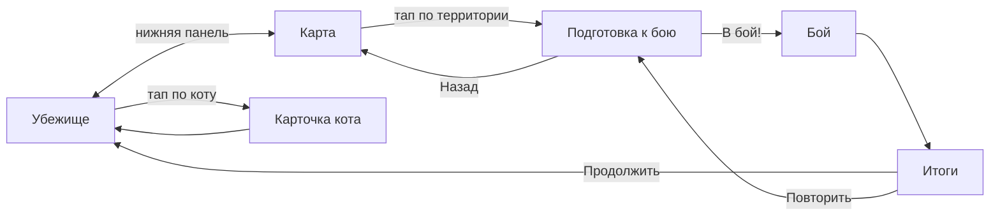

# Trash Cats — UI / UX

> Статус: черновик GDD v0.1. Обозначения: ✅ подтверждено, 🔶 стартовое значение, 🧪 требует плейтеста.
> Вайрфреймы показывают только структуру, не стиль. Стиль определяется в фазе F (арт-дирекшн).

## 1. Принципы
1. **Одна рука, большой палец.** Все частые действия — в нижних 40% экрана.
2. **Не больше 2 тапов** до любого частого действия (назначить занятие, покормить).
3. **Состояние видно без меню.** Над каждым котом видно занятие, прогресс, потребности и причину остановки.
4. **Нет модалок поверх модалок.** Максимум один popup одновременно, остальные — в очередь.
5. **Safe Area** соблюдается везде; фон сцены может уходить под вырезы, интерактивные элементы — нет.

## 2. Инвентарь экранов ✅

| # | Экран | Тип | Назначение |
|---|---|---|---|
| 1 | **Убежище** (Hideout) | Основной экран | Сцена с котами и объектами, назначение занятий, улучшения |
| 2 | **Карточка кота** (Cat Details) | Нижний лист (bottom sheet) поверх Убежища | Атрибуты, опыт, умения и слоты, кормление |
| 3 | **Карта территорий** (Map) | Основной экран | Выбор территории, статус захвата, бонусы |
| 4 | **Подготовка к бою** (Battle Prep) | Полный экран | Враги, состав, порядок, слоты |
| 5 | **Бой** (Combat) | Полный экран | Проигрывание боя |
| 6 | **Итоги боя** (Results) | Модальное окно поверх Боя | Победа/поражение, награды, изменения |
| — | Popups | Модальные карточки | Награды, уровень, новое умение, новый кот, территория, улучшение, «Пока тебя не было», финал |

## 3. Навигация



- Нижняя панель с двумя вкладками: **Убежище | Карта** 🔶. Вкладки нет в Бою и Подготовке.
- Аппаратная/жестовая кнопка «Назад» (Android): закрывает верхний popup/лист; на Подготовке — к Карте; в Бою — ничего (или «Пропустить», если доступно); на Убежище — диалог выхода.

## 4. Экран «Убежище»

```
┌─────────────────────────────────┐  ← Safe area top
│ 🍗 24   🔩 13            ⚙      │  HUD: Еда, Хлам, настройки
├─────────────────────────────────┤
│                                 │
│   [Банка]    [Мышь]   [Колесо]  │  Сцена (≈55% высоты):
│     🐱≡          🐭      🐈      │  объекты-станции,
│                                 │  коты на местах занятий,
│  [Мусорный бак]     [Коробки]   │  тап по объекту → улучшение
│      🐈 ...            💤       │
│                                 │
├─────────────────────────────────┤
│ ┌───────┐ ┌───────┐ ┌───────┐   │  Панель котов (3 карточки):
│ │Рыжий  │ │Шнырь  │ │  🔒   │   │  портрет, занятие + прогресс,
│ │Сила ▓▓░│ │Сон ▓░░│ │Тёмный │   │  ⚡ Энергия, 🍗 Сытость
│ │⚡▓▓░ 🍗▓░│ │⚡▓░░ 🍗▓▓│ │переулок│   │  пузырь причины остановки
│ │  [🍗]  │ │  [🍗]  │ │       │   │  быстрая кнопка «Покормить»
│ └───────┘ └───────┘ └───────┘   │
├─────────────────────────────────┤
│     [ Убежище ]   [ Карта ]     │  Нижняя навигация
└─────────────────────────────────┘  ← Safe area bottom
```

### 4.1. Назначение занятия ✅ (схема взаимодействия 🔶)
1. Тап по карточке кота (или по самому коту в сцене) → **лист занятий** снизу:
```
┌──────── Рыжий ─────────────────┐
│ ⚡ 45  🍗 30        [Подробнее] │
│ ┌──────┐ ┌──────┐ ┌──────┐     │
│ │Еда   │ │Хлам  │ │ Сон  │     │
│ │20с +3│ │25с +3│ │15с+25│     │
│ └──────┘ └──────┘ └──────┘     │
│ ┌──────┐ ┌──────┐ ┌──────┐     │
│ │Сила  │ │Ловк. │ │Креп. │     │
│ │+15 XP│ │Занято│ │+10 XP│     │
│ │      │ │Шнырь │ │      │     │
│ └──────┘ └──────┘ └──────┘     │
│ [🍗 Покормить (−7)]   [■ Стоп] │
└────────────────────────────────┘
```
2. Тап по занятию → кот идёт к станции, лист закрывается.
3. Недоступные кнопки серые, с причиной: «Устал», «Занято: Шнырь», «MAX».
4. Голодный кот: кнопки активны, но с пометкой «×2 время» (жёлтая).
5. «Подробнее» → Карточка кота.

### 4.2. Улучшения
Тап по объекту в сцене → маленькая панель над объектом: текущий и следующий эффект, цена, кнопка «Улучшить». Если хлама не хватает, кнопка неактивна и показывает «Нужно ещё N».
Значок ⬆ над объектом, когда улучшение доступно по деньгам.

## 5. Карточка кота (bottom sheet ~85% высоты)

```
┌──────────────── ✕ ─────────────┐
│  [Портрет]  РЫЖИЙ              │
│            Склонность: Сила ★  │
│  ⚡ 45/100   🍗 30/100  [🍗]   │
├────────────────────────────────┤
│ Сила ★   7  ▓▓▓▓▓░░░  31/52    │
│ Ловкость 3  ▓░░░░░░░   5/24    │
│ Крепость 4  ▓▓▓░░░░░  20/31    │
│ HP 88 · Задор 40 · Урон 18     │
├────────────────────────────────┤
│ Умения (3 слота)               │
│ [Укус] [Густая шерсть] [Трюк]  │
│ Доступно: Двойная лапа (ЛОВ 4)🔒│
│ Царапина — всегда              │
└────────────────────────────────┘
```
- Тап по слоту → список открытых умений, тап по умению → поставить. Тап по закрытому умению показывает условие.
- Свайп влево/вправо — следующий кот 🔶.

## 6. Карта территорий

```
┌─────────────────────────────────┐
│ 🍗 24   🔩 13                   │
│        ┌──────────┐             │
│        │ 🏠 Крыша │ 🔒 БОСС      │
│        └────┬─────┘             │
│        ┌────┴─────┐             │
│        │  Парк    │ ⚔ Доступно  │
│        └────┬─────┘             │
│        ┌────┴─────┐             │
│        │ Переулок │ ✔ +25% хлам │
│        └────┬─────┘             │
│        ...                      │
│        ┌──────────┐             │
│        │ Мусорка  │ 🏠 База     │
│        └──────────┘             │
│     [ Убежище ]   [ Карта ]     │
└─────────────────────────────────┘
```
Вертикальный путь снизу вверх (крыша наверху). Состояния узла: 🔒 закрыто, ⚔ доступно (пульсирует), ✔ захвачено (показан бонус; тап — повторный бой).

## 7. Подготовка к бою

```
┌──────── Тёмный переулок ───────┐
│ ВРАГИ:                         │
│ 1 [Ворона] 4/7/3  ДвЛапа Уворот│
│ 2 [Громила] 6/4/5  Укус Трюк    │
├────────────────────────────────┤
│ ТВОЯ ОЧЕРЕДЬ (перетащи):       │
│ 1 [Шнырь] 4/7/4  ⚡80  [умения]│
│ 2 [Рыжий] 7/3/4  ⚡55  [умения]│
│ 3 [ пусто ]                    │
├────────────────────────────────┤
│ Доступные коты:                │
│ [Пончик ⚡15 — устал]           │
├────────────────────────────────┤
│ Награда: 🍗15 🔩25 +Пончик     │
│ [ Назад ]          [ В БОЙ! ]  │
└────────────────────────────────┘
```
- Тап по коту из «Доступных» добавляет его в конец очереди; тап по коту в очереди убирает его; перетаскивание меняет порядок.
- «[умения]» раскрывает слоты прямо здесь (тот же выбор, что в Карточке).
- Кот с ⚡ < 20 неактивен с подписью «устал».
- Занятый кот помечен иконкой занятия; после «В бой!» появляется одно общее подтверждение: «Шнырь бросит тренировку. Продолжить?» ✅.
- «В бой!» неактивна, если очередь пуста.

## 8. Экран боя

```
┌─────────────────────────────────┐
│ [🐱][🐱][  ]   vs   [🐦][🐀]     │  Очереди (выбывшие перечёркнуты)
│                                 │
│         Укус!                   │  Плашки умений
│     🐱 ───────────►  🐦  -24     │  Бойцы крупно, лицом друг к другу
│                                 │
│ HP ▓▓▓▓▓▓░░ 62     HP ▓▓░░ 20   │
│ ⚡▓▓▓░░ 🛡x2         ⚡▓▓░░ 😵    │  Задор, баффы/дебаффы
│                                 │
│ [ ×1 / ×2 ]        [Пропустить] │  Пропуск — только на повторных
└─────────────────────────────────┘
```
- Бойцы занимают центральные ~50% экрана. Арена — фон территории.
- Выбор ×1/×2 запоминается между боями ✅.

## 9. Итоги боя (модальное окно)

```
┌──────── ПОБЕДА! ───────────────┐
│ Задний двор захвачен           │
│ 🍗 +10   🔩 +10                │
│ Рыжий: +8 опыта ко всем, ⚡−30  │
│ Новый бонус: Тихий двор         │
│ [ Продолжить ]                 │
└────────────────────────────────┘
```
После «Продолжить» по очереди показываются popup'ы: новый уровень → новое умение → **новый кот** → новая территория.
Поражение: «Поражение» + подсказка-анализ 🔶. Например: «Громила попадал Укусом 4 раза — попробуй Уворот» (правило-шаблон по логу боя). Это прямо поддерживает критерий успеха №2. Подробнее — в [OPEN_QUESTIONS.md](OPEN_QUESTIONS.md).

## 10. Popups и очередь уведомлений

| Popup | Триггер | Поведение |
|---|---|---|
| Награда | Окно итогов, офлайн | Входит в окно итогов / сводку |
| Новый уровень атрибута | Повышение уровня | **Тост** сверху (не модалка), 2 с, не блокирует |
| Новое умение | Порог атрибута | Модалка с описанием и кнопками «В слот» / «Позже» |
| Новый кот | Вербовка | Модалка с портретом и склонностью |
| Территория открыта | Победа | Модалка, кнопка «На карту» / «Позже» |
| Улучшение | Покупка | Тост + анимация объекта |
| Пока тебя не было | Возврат после ≥ 1 мин 🔶 | Модалка-сводка |
| Финал | Победа над боссом | Полноэкранная, «Продолжить играть» |

Правила: модалки идут в **очередь FIFO**, одновременно не больше одной. Тосты складываются стопкой до 3. Во время Боя модалки откладываются до окна итогов.

## 11. Онбординг ✅

**Ведущая цепочка (первые 2–3 мин):** затемнение с вырезом и стрелкой на нужный элемент, одна короткая фраза.
1. «Рыжий голоден. Отправь его за едой» → тап по карточке → «Еда».
2. (через 20 с) «Покорми Рыжего» → кнопка 🍗.
3. «Потренируй Силу на банке» → «Сила».
4. (при Силе 4) «Новое умение!» — popup.
5. «Рыжий устал — уложи спать» (когда ⚡ < 20).
6. «Пора проучить Крысу!» → Карта → Задний двор → В бой.

**Контекстные подсказки (однократные):** первый Хлам → «Хлам тратится на улучшения, тапни по объекту»; первый новый кот → «Тренажёр вмещает одного кота»; первая эстафета (2+ кота) → «Порядок важен: победитель остаётся на ринге»; первые 4 открытых умения → «Слотов только 3»; первое поражение → «Коты устали. Отдохни, потренируйся и попробуй снова».

Цепочку можно пропустить кнопкой «Пропустить обучение» 🔶.

**Реализация (2026-10-13, M5-05):** `TutorialService` (App) + `TutorialOverlay` (Presentation), прогресс — `TutorialState` в мире и в сохранении.
- Цепочка: «Отправь за едой» → (после первой добычи) «Покорми» → «Тренируй Силу» → (умение открылось, слоты пусты) «Возьми в слот» → (энергия < 20) «Уложи спать» → (после сна или первого роста атрибута) «Нападай: Задний двор». Шаг ждёт своей ситуации, игрок между шагами свободен.
- Оверлей: затемнение с вырезом, жёлтая рамка, лапа-указатель, фраза и «Пропустить обучение»; тапы вне цели блокируются. Прячется, пока сверху чужая модалка или цель недоступна.
- Разовые подсказки: первый Хлам, первая подготовка с 2+ котами (эстафета), открыто больше 3 умений. Про нового кота и про слоты уже говорят сообщения о вербовке и умении.
- Старые сохранения с прогрессом (2+ кота или захваченная территория) пропускают цепочку.

## 12. Обратная связь в убежище
- Прогресс-бар цикла над котом и в карточке.
- По завершении цикла над котом всплывает иконка результата (+3 🍗, +15 ⭐ Сила).
- Пузыри причин остановки (💤 / 🍗 / ✔ / MAX) с лёгкой пульсацией, пока кот стоит без дела.
- Индикатор на вкладке «Карта», если доступна новая территория.

## 13. Портретная раскладка и Safe Area
- Референс 1080×1920 (9:16). Поддерживаем от 9:16 до 9:21 (вытянутые экраны) и iPad 3:4 🔶.
- Canvas Scaler: Scale With Screen Size, match = 0.5 → проверить, при необходимости match по ширине 🔶.
- Все интерактивные элементы — внутри Safe Area (компонент-подгонщик по `Screen.safeArea`). Фон сцены и арена — на весь экран.
- Минимальный размер тап-зоны — 120×120 px при референсе (~9 мм).
- На вытянутых экранах дополнительная высота уходит в сцену убежища, а не в панели.
- Текст: минимум 32 px при референсе. Цифры ресурсов и HP — 40+ px.

## 14. Состояния UI (для архитектуры)

| Состояние | Доступные действия |
|---|---|
| `Hideout` | Всё в убежище, переход на Карту |
| `Hideout + Sheet` | Действия листа; тап вне листа закрывает его |
| `Map` | Выбор территории, переход в Убежище |
| `BattlePrep` | Состав, слоты, Назад, В бой |
| `Combat` | ×1/×2, Пропустить (на повторах) |
| `Results` | Продолжить / Повторить |
| `Tutorial step` | Только выделенный элемент |
| `Popup queue active` | Только текущий popup |
