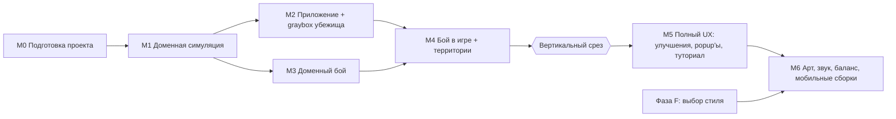

# Trash Cats — Дорожная карта разработки

> **Статус на 2026-10-14:** M0 ✅, M1 ✅, M2 ✅ (кроме проверки на устройстве), M3 ✅ (баланс настроен), M4 ✅ (вертикальный срез играбелен), M5 — частично (улучшения, карточка кота, сообщения; нет туториала, локализации, настроек), M6 — частично (первый проход графики из GPT; нет звука, TMP-шрифта, UI-скина). Отчёт: `MORNING_REPORT_2026-10-14.md`.

> Статус: черновик v0.1 (фаза E). **План, не исполняется до явного разрешения на разработку.**
> Основан на утверждённых `Docs/GDD/` и `Docs/Architecture/`.

## 1. Принципы плана
1. **Порядок — по реальным зависимостям**, а не по списку фич. Домен без UI → приложение → презентация. Бой разрабатывается параллельно, потому что зависит только от домена.
2. **Каждая задача — одна ветка, один ревью**, 0.5–1.5 дня работы. Задача считается сделанной, только когда зелёные тесты подтверждают её критерии.
3. **Сначала инструменты баланса, потом числа.** Симулятор боя и «бот-прохождение» экономики строятся вместе с системами.
4. **Graybox до арта.** Всё играбельно на заглушках; арт подключается после фазы F без переделки логики.

Оценки сложности: **S** ≤ 0.5 дня, **M** ~1 день, **L** ~1.5 дня (один разработчик). Оценки грубые 🧪.

## 2. Зависимости майлстоунов

**Отличия от исходного предложения брифа:**
- **Тренировки входят в M1**, а не идут отдельным майлстоуном: тренировка — это занятие с тем же кодом цикла.
- **Сохранения перенесены из M5 в M2**: без них нельзя проверить офлайн-прогресс на устройстве, а это технический риск №1.
- **Домен улучшений — в M1, их UI — в M5**: бонусы встраиваются в формулы занятий сразу, иначе их пришлось бы потом переписывать.
- **Бой (M3) идёт параллельно с M2**: он зависит только от домена.

## 3. Самый маленький играбельный вертикальный срез

**Определение (после M4):** новая игра → Рыжий в graybox-убежище добывает еду, ест, тренируется, спит (с автоповтором и офлайн-прогрессом) → бой на Заднем дворе на graybox-арене → победа → приходит Шнырь → бой в Рыбной лавке эстафетой 2v2 → игра сохраняется и восстанавливается после перезапуска.

**Что срез НЕ включает:** улучшения в UI, popup-очередь (только простые уведомления), туториал, арт, звук.

**Зачем:** это минимальная проверка главной гипотезы — «распределять котов и готовить их к бою интересно». Внутренний плейтест среза — до начала M5. Если гипотеза не подтверждается, мы меняем дизайн, а не полируем.

---

## M0 — Подготовка проекта

| | |
|---|---|
| **Цель** | Чистый каркас проекта, в котором можно писать и тестировать код по архитектуре |
| **Зависимости** | Разрешение на разработку |
| **Сложность** | S–M, ~1 день |

**Задачи**
| ID | Задача | Слож. |
|---|---|---|
| M0-01 | `git init`, `.gitignore` для Unity, первый коммит в `main` с текущим проектом и `Docs/` | S |
| M0-02 | Установить пакеты: UniTask, DOTween, Newtonsoft JSON; зафиксировать версии в `Docs/Architecture` | S |
| M0-03 | Структура `Assets/_Project/...`, asmdef'ы `Domain` и `Application` (`noEngineReferences`), `Infrastructure`, `Presentation`, `Tests.EditMode`, `Tests.PlayMode` с правильными ссылками | S |
| M0-04 | Сцены `Boot` и `Game`, пустой `GameBootstrap` и `GameSceneRoot`; Build Settings; портрет 1080×1920 в Player Settings | S |
| M0-05 | Тест-«дымок» в каждой тестовой сборке; проверка, что Domain не может сослаться на UnityEngine (тест-компиляция) | S |

**Критерии приёмки:** проект открывается без ошибок; Test Runner запускает EditMode- и PlayMode-тесты (зелёные); Play из Boot загружает Game.
**Риски:** T10 (установка DOTween вне UPM).
**DoD:** всё в `main`, сборки и тесты зелёные, версии пакетов записаны.

---

## M1 — Доменная симуляция (без UI)

| | |
|---|---|
| **Цель** | Все правила убежища реализованы и покрыты тестами: коты, потребности, занятия (включая тренировки), ресурсы, улучшения, время, офлайн |
| **Зависимости** | M0 |
| **Сложность** | L, ~5–6 дней |

**Задачи**
| ID | Задача | Слож. |
|---|---|---|
| M1-01 | Доменные id-типы, `GameConfig`-записи, `Validate()`, `TestConfigs.Default()` (значения из GDD) | M |
| M1-02 | `DeterministicRng` + golden-тест последовательности | S |
| M1-03 | `Cat`: атрибуты, опыт, `XpToNext`, мультиуровень, кап 10, открытие умений, события | M |
| M1-04 | Потребности: обрезка, пороги, `Feed` | S |
| M1-05 | `Wallet` | S |
| M1-06 | `Upgrades`: уровни, покупка, эффекты (сон, выход ресурсов, бонус станции) | S |
| M1-07 | Агрегатор бонусов (улучшения сейчас, территории — через тот же интерфейс в M4) | S |
| M1-08 | `Activities`: `CanStart` (все причины отказа), `Start` (голод ×2), `CompleteCycle` (атомарно), `Stop`, автоповтор с `HungryOverride` | L |
| M1-09 | `GameWorld`, `IReadOnlyGameWorld`, `CreateNew` | S |
| M1-10 | `Simulation.AdvanceTo` (хронологический порядок, автоповтор в момент завершения) | M |
| M1-11 | Проверка инвариантов (Debug), вызывается в тестах после каждого шага | S |
| M1-12 | Тесты: эквивалентность «большой шаг = много маленьких», отсутствие тупика (property-based на случайных состояниях), все граничные случаи CORE_SYSTEMS §3.5 | M |
| M1-13 | **Бот-прохождение экономики** (EditMode, отчёт): простая стратегия назначает занятия 40 игровых минут → таблица «время → уровни, Еда, Хлам». Первая проверка кривой из PROGRESSION §6–8 | M |

**Критерии приёмки**
- Каждое правило из CORE_SYSTEMS §2–3 и §5–7 покрыто хотя бы одним тестом.
- Офлайн-догон на 60 мин даёт **побитово то же состояние**, что 36 000 шагов по 100 мс.
- Инварианты не нарушаются ни в одном тесте.
- Бот-прохождение выдаёт отчёт; расхождения с ожидаемой кривой заносятся в OPEN_QUESTIONS (не исправляются вслепую).

**Тесты:** EditMode, ~60–80 тестов. **Риски:** T1, T3.
**DoD:** все задачи смёржены, тесты зелёные, в `Domain` нет ссылок на UnityEngine, отчёт бота приложен в PR M1-13.

---

## M2 — Приложение и graybox убежища

| | |
|---|---|
| **Цель** | Играбельное убежище на заглушках: назначение занятий, кормление, прогресс, сохранение, офлайн-сводка |
| **Зависимости** | M1 |
| **Сложность** | L, ~5–6 дней |

**Задачи**
| ID | Задача | Слож. |
|---|---|---|
| M2-01 | `EventBus` (синхронный, реентрантность через очередь) + тесты | S |
| M2-02 | `GameSession` + команды `AssignActivity`, `StopActivity`, `FeedCat`, `EquipSkill`; `CommandResult`/`ErrorCode` + тесты на фейковых часах | M |
| M2-03 | `TimeService.Tick` (Δ, лимит, перевод часов назад, сводка) + тесты | S |
| M2-04 | `SaveMapper` (DTO ↔ мир), `SaveService`/`SaveScheduler`, миграционный каркас + тесты round-trip и восстановления цикла | M |
| M2-05 | `JsonFileSaveStorage` (атомарная запись, бэкап) + `AppLifecycleListener` | M |
| M2-06 | `ConfigLoader` + SO-ассеты с значениями GDD; тест «ассеты = TestConfigs» | M |
| M2-07 | `GameBootstrap` (Composition Root), `GameSceneRoot.Construct`, `ScreenRouter` (каркас экранов и слоёв) | M |
| M2-08 | Graybox `HideoutView`: станции-прямоугольники, `CatView`-заглушки (цветной спрайт + DOTween-«дыхание»), перемещение к станции | M |
| M2-09 | `CatPanelView` (3 карточки, бары, прогресс, быстрое кормление) + `HudView` | M |
| M2-10 | `ActivitySheet` (6 занятий, причины недоступности, «×2 время», Стоп, Покормить) | M |
| M2-11 | Простой модальный показ офлайн-сводки + тосты результатов цикла | S |
| M2-12 | Debug-панель (Development): масштаб времени, +ресурсы, сброс сохранения, перемотка | S |
| M2-13 | `SafeAreaFitter` + проверка в Device Simulator | S |
| M2-14 | Тестовая сборка Android (IL2CPP): сохранение/загрузка, сворачивание, офлайн | M |

**Критерии приёмки**
- С нуля: Рыжий добывает еду, ест, тренирует Силу до 4, засыпает; всё видно на экране без отладчика.
- Свернуть на 5 минут → вернуться → сводка совпадает с тем, что было бы при открытой игре.
- Убить процесс → перезапуск → потеря ≤ 30 с.
- Ни одна MonoBehaviour не содержит формул или порогов (ревью).

**Тесты:** EditMode (Application, Save), PlayMode smoke (Boot → Game → команда из UI меняет состояние). **Риски:** T4, T5, T12, T15.
**DoD:** задачи смёржены; Android-сборка проверена вручную по чек-листу; тесты зелёные.

---

## M3 — Доменный бой (параллельно с M2)

| | |
|---|---|
| **Цель** | Детерминированная симуляция боя-эстафеты с ИИ и инструментом баланса |
| **Зависимости** | M1 (Config, Rng, снимки котов) |
| **Сложность** | M–L, ~4 дня |

**Задачи**
| ID | Задача | Слож. |
|---|---|---|
| M3-01 | `CombatFormulas` (HP, Задор, урон, интервал, попадание; ‰-арифметика) + табличные тесты | S |
| M3-02 | `FighterRuntime`, тиковый цикл, очерёдность (техника, сторона игрока) | M |
| M3-03 | Умения: урон/мульти-удар, Густая шерсть, Уворот, Грязный трюк, перезарядки, Задор | M |
| M3-04 | `CombatAi` (приоритеты GDD §6) + тест на каждое правило | S |
| M3-05 | Эстафета: выбывание, вход следующего, сохранение HP/Задора, сброс баффов и перезарядок; «Ярость»; защитный лимит | M |
| M3-06 | `BattleEvent`-лог + golden-тесты (3–4 сценария, включая пример из COMBAT_DESIGN §12) | S |
| M3-07 | **Балансный симулятор**: каждая территория × ожидаемый состав (PROGRESSION §6) × 1000 seed → шанс победы; отчёт + мягкие проверки коридоров | M |
| M3-08 | Генератор «подсказки поражения» по логу (3–5 правил) + тесты | S |

**Критерии приёмки:** одинаковые вход и seed дают идентичный лог (golden); все умения и правила ИИ покрыты; отчёт симулятора приложен, отклонения от коридоров записаны в OPEN_QUESTIONS (C2, C6, C7).
**Тесты:** EditMode. **Риски:** T2, T3.
**DoD:** задачи смёржены; COMBAT_DESIGN обновлён, если тюнинг чисел был согласован с пользователем.

---

## M4 — Бой в игре и территории

| | |
|---|---|
| **Цель** | Полный цикл «подготовка → бой → итоги → награды/вербовка → следующая территория» в graybox |
| **Зависимости** | M2, M3 |
| **Сложность** | L, ~5 дней |

**Задачи**
| ID | Задача | Слож. |
|---|---|---|
| M4-01 | `Territories` домен: статусы, попытки, награды первая/повтор, бонусы (через агрегатор M1-07), вербовка, финал + тесты | M |
| M4-02 | `BattleService.Start/Complete`, `PendingBattle`, немедленные сохранения; команды `StartBattle`/`CompleteBattle` + тесты (последствия только вышедшим на ринг, перезапуск с ожиданием) | M |
| M4-03 | `MapScreen` (graybox-узлы, статусы, бонусы) | S |
| M4-04 | `BattlePrepScreen`: враги, очередь (тапы + перетаскивание), слоты умений, недоступные коты, подтверждение отмены занятий | L |
| M4-05 | `CombatScreen` + `BattlePlayer` (UniTask): проигрывание лога, цифры, плашки, бары, очереди, ×1/×2, пропуск на повторах | L |
| M4-06 | `ResultsModal` (победа/поражение, награды, подсказка поражения, Продолжить/Повторить) | S |
| M4-07 | Вербовка в сцене (появление кота), обновление панели котов | S |
| M4-08 | Восстановление `PendingBattle` при запуске → сразу итоги | S |
| M4-09 | **Внутренний плейтест вертикального среза** (чек-лист + заметки) | M |

**Критерии приёмки (= вертикальный срез, §3)**
- Пройти из новой игры через Задний двор и Рыбную лавку без отладочных инструментов.
- Убить приложение посреди показа боя → перезапуск → те же итоги.
- Во время боя остальные коты продолжают занятия.

**Тесты:** EditMode (Territories, BattleService), PlayMode smoke (Map → Prep → Combat → Results). **Риски:** T9.
**DoD:** срез играбелен; итоги плейтеста записаны в OPEN_QUESTIONS; **решение пользователя «продолжаем / меняем дизайн»** до старта M5.

---

## M5 — Полный UX

| | |
|---|---|
| **Цель** | Все системы GDD доступны игроку с понятной обратной связью; прототип проходится целиком в graybox |
| **Зависимости** | Вертикальный срез принят |
| **Сложность** | L, ~5 дней |

**Задачи**
| ID | Задача | Слож. |
|---|---|---|
| M5-01 | UI улучшений: тап по объекту, панель, индикатор ⬆, смена graybox-визуала уровня; команда `BuyUpgrade` | M |
| M5-02 | `CatDetailsSheet`: атрибуты, опыт, производные статы, слоты, условия закрытых умений, свайп между котами | M |
| M5-03 | `NotificationQueue` + `PopupPresenter`/`ToastView` (FIFO, приоритеты, подавление в бою) + тесты | M |
| M5-04 | Popup'ы: новое умение («В слот»), новый кот, территория, финальный экран | S |
| M5-05 | `TutorialService` + `TutorialOverlay` + `TutorialTargetRegistry`: ведущая цепочка и контекстные подсказки, пропуск + тесты сервиса | L |
| M5-06 | Пузыри причин остановки, индикатор новой территории на вкладке «Карта» | S |
| M5-07 | Локализация: таблица строк (RU), все строки UI через ключи | M |
| M5-08 | Настройки: громкость, сброс прогресса, кнопка «Назад» Android | S |
| M5-09 | Полный проход прототипа в graybox с debug-ускорением + без него (замер времени) | M |

**Критерии приёмки:** все 6 экранов и все popup'ы GDD работают; новый игрок проходит онбординг без подсказок разработчика; прохождение без ускорения укладывается в 30–50 мин (иначе — тюнинг с пользователем).
**Тесты:** EditMode (уведомления, туториал), PlayMode smoke-маршрут по всем экранам. **Риски:** T11, T12, T13.
**DoD:** прототип полностью проходим в graybox; замер времени записан.

---

## M6 — Арт, звук, баланс, мобильные сборки

| | |
|---|---|
| **Цель** | Прототип в выбранном стиле, готовый к внешнему плейтесту |
| **Зависимости** | M5, **фаза F** (утверждённый стиль и Art Bible), арт-ассеты |
| **Сложность** | L+, 5–10 дней (сильно зависит от стиля и готовности ассетов) |

**Задачи**
| ID | Задача | Слож. |
|---|---|---|
| M6-01 | Реализация `ICatAnimator` под выбранную технологию (2D Animation / покадровая / Spine) | M |
| M6-02 | Интеграция ригов котов и врагов, анимации по CONTENT_SPEC §8 | L |
| M6-03 | Фоны убежища и арен, объекты по уровням | M |
| M6-04 | UI-скин по Art Bible | L |
| M6-05 | VFX (CONTENT_SPEC §9) | M |
| M6-06 | SFX (+ музыка опционально) | M |
| M6-07 | Балансный проход: симулятор + бот + 2–3 ручных прохождения, согласование чисел с пользователем | M |
| M6-08 | Сборки Android и iOS, проверка на 2–3 устройствах, производительность (60 FPS на среднем Android) | M |
| M6-09 | Телеметрия плейтеста: локальный лог событий (время, бои, слоты, порядок) для критериев успеха GAME_OVERVIEW §9 | S |

**Критерии приёмки:** проходимо на устройствах; читаемость котов и боя подтверждена на телефоне; телеметрия пишет данные для 5 критериев успеха.
**Риски:** T7, T8, T3.
**DoD:** сборки для внешнего плейтеста готовы; чек-лист плейтеста подготовлен.

---

## 4. Сводка

| Майлстоун | Сложность | Оценка (дни) | Можно параллелить |
|---|---|---|---|
| M0 | S–M | ~1 | — |
| M1 | L | 5–6 | — |
| M2 | L | 5–6 | с M3 |
| M3 | M–L | ~4 | с M2 |
| M4 | L | ~5 | — |
| M5 | L | ~5 | — |
| M6 | L+ | 5–10 | частично с M5 (после фазы F) |
| **Итого** | | **~30–37 дней** одного разработчика 🧪 | |

## 5. Git-процесс (когда разработка будет разрешена)

1. Начинать от свежего `main`.
2. Одна задача (или тесно связанная пара задач) = одна ветка: `feature/m1-08-activities`, `fix/...`, `docs/...`.
3. Реализовать один связный кусок.
4. Запустить EditMode-тесты (и PlayMode, если задеты Presentation/сцены); проверить, что в `Domain`/`Application` нет ссылок на Unity.
5. Ревью изменений: самопроверка по критериям задачи + показ диффа пользователю.
6. Мёрж в `main` после успешной проверки (fast-forward или squash по договорённости).
7. Новая ветка для следующей задачи.

Сцены и префабы — конфликтные бинарно-YAML файлы. Их меняет одна ветка за раз, и такие изменения отмечаются в описании PR.

## 6. Что требует решения пользователя по ходу
| Момент | Решение |
|---|---|
| Перед M0 | Явное разрешение на разработку |
| После M1-13 / M3-07 | Согласовать изменения чисел баланса, если отчёты расходятся с GDD |
| После M4 (срез) | Продолжаем / меняем дизайн |
| Перед M6 | Выбранный стиль (фаза F), источник арт-ассетов |
| После M6 | Внешний плейтест |
